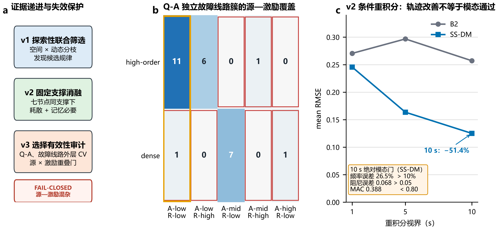

# 数据资格先于阶次选择：M0-AFSD 电力系统动态等值的联合选择有效性研究报告

[返回主题页](../README.md)

## 运行结果与归档

- [运行归档说明](../../../../results/backup/02_afsd_structure_discovery/C_afsd_v3_joint_selection_validity.DESCRIPTION.md)

登记文件与配置

[方案配置](../../../../configs/experiments/paper_m0_afsd_v3_joint_selection_validity_f1_seed324.toml)

## 执行协议

### M0-AFSD v3 joint-selection validity protocol

#### Scope

This workflow audits whether F1/seed324 contains enough source-balanced,
fault-line-independent Q-A evidence to support joint selection of spatial
resolution, effective dynamic order, closure modules and equivalent graph
support.  It is independent of the v1 and v2 result directories.  Existing
model classes may be reused as software components; prior response metrics,
checkpoints and selections may not be read.

Observed `Pm(t)` is the registered conditional-rollout input.  Test, F2--F5
and canonical-data mutation remain locked.

#### Mandatory order

Every round is executed in this order:

1. hypothesis registration;
2. eligibility and source--excitation overlap audit;
3. controlled experiment;
4. residual diagnosis;
5. adversarial review;
6. acceptance or rejection.

Structure, order, partition and support selection may use only Q-A F1-train
trajectories.  Q-B trajectories may be used only after support is frozen for
parameter robustness and rollout extrapolation.  Q-C trajectories are
excluded.  Fault line is the independent grouping and primary weighting unit.

#### Fail-closed precondition

For every amplitude--richness cell represented in the Q-A design, each source
must provide at least five independent fault-line clusters, and at least one
cell must be directly comparable.  A source-exclusive excitation cell counts
as zero support for the absent source.  When this condition is not met, the
controlled model lattice is not fitted and the admissible terminal conclusion
is `SOURCE_EXCITATION_CONFOUNDED`.  This is an accepted negative scientific
result, not evidence that a dynamic module is absent.

#### Candidate lattice after eligibility PASS

Spatial candidates are train-discovered 5--9-node partitions, a fixed
seven-node control and the raw ten-machine control.  B2 at H=100 screens the
spatial family; candidates within 5% of the best plus both controls proceed to
H=100/500/1000.

Dynamic candidates are B2, the preregistered full M0-3EG alpha/tau grid, BS,
single-time-scale B4, multi-rank/multi-time-scale BM and all eight conservative,
dissipative and memory same-support PSD combinations.  Complexity is the
lexicographic tuple of total state count, active parameters, active edges and
spatial coordinates.  A module count is not a complexity surrogate.

#### Statistical contract

The outer five fault-line folds estimate branch performance.  Inner four-fold
splits select partitions, support and hyperparameters.  The primary estimand is
the equal-fault-line mean; event-weighted results are secondary.  Paired
inference uses 5,000 fault-line bootstrap draws, exact sign flips up to 15
clusters and 10,000 random sign flips above that threshold.  Module knockouts
use Holm correction.

The original F1 validation set is confirmation-only after all rules are
frozen.  It cannot revise a threshold, support or branch.

#### Claim boundary

Even after a positive outcome, the selected graph is a dynamic equivalent,
not the IEEE39 physical topology.  Learned parameters are effective coordinate-
conditioned parameters.  A parameter-recovery claim additionally requires full
active rank, condition number below `1e8`, 95% sign stability and no more than
20% normalized drift across outer folds.  Failure returns
`PARAMETER_NOT_IDENTIFIABLE` and retains the declared-prior rollout.

## 报告与结果

### 数据资格先于阶次选择：M0-AFSD 电力系统动态等值的联合选择有效性研究报告

**正式论文前关键节点报告｜版本：v3 merge gate｜日期：2026-08-13**

**研究范围：** IEEE39 canonical post-clear 数据；F1；seed 324；test 与 F2–F5 锁定；observed \(P_m(t)\) 条件重积分。

**一句话结论：** M0-AFSD 已建立从数据资格、空间分辨率、动态阶次到物理闭合模块的可证伪选择框架；固定七节点上的耗散—记忆闭合显著改善了 10 s 条件重积分，但当前 F1 数据不能把“激励增强”与“数据来源改变”分离，因此 v3 正确终止于 `SOURCE_EXCITATION_CONFOUNDED`，尚不能声称完成了未知电力系统的联合自适应阶次发现。

---

#### 摘要

未知电力系统的动态等值不能仅以一步拟合误差或稳定分类精度为目标：一个可用模型还必须在闭环重积分中保持轨迹、振荡模态、稳定性和物理约束，并且只能对已被扰动充分激发、可由观测量辨识的结构作出结论。为此，本研究提出 M0-AFSD（Adaptive Fidelity and Structure Discovery），在 COI 商空间内将积分弱形式辨识、空间聚合、动态阶次、图支撑、端口结构闭合和失效保护联合起来。算法以二阶 swing 平衡为物理骨架，比较节点暂态电势、静态结构闭合和多时间尺度边记忆，并以故障线路为独立统计单元评估 1、5、10 s 重积分及工程模态。

研究经历三个递进版本。v1 在 F1/seed324 上探索性地选择了低丰富度数据的原始十机 BM-r 和丰富数据的七节点 PSD-B4，但其 C3 支撑发现混入 Q-B 样本，且数据来源与激励水平高度相关。v2 在固定七节点和完全相同的候选支撑上进行八种保守、耗散和记忆模块消融，选择耗散—记忆组合 SS-DM；其 10 s mean RMSE 由 B2 的 0.2571 降至 0.1251，相对改善 51.35%，失败率为零，COI 漂移低于 \(10^{-15}\)，RK4 步长误差呈约四阶收敛。然而 SS-DM 的频率相对误差、阻尼绝对误差和 MAC 分别为 26.5%、0.068 和 0.388，均未通过 v3 预注册的绝对模态门。因此它只能称为“条件重积分准确的动态等值”，不能称为已保持振荡模态的系统等值。

v3 引入仅 Q-A 可参与结构选择、五折外层/四折内层 fault-line CV、5000 次 cluster bootstrap、完整 M0-3EG 网格和参数可辨识门。资格审计得到 95 条 Q-A 训练事件和 23 个独立故障线路簇，但唯一同时包含两个来源的 A-low/R-low 单元只有 11 个 high-order 线路簇和 1 个 dense 线路簇，未达到每来源至少 5 个簇的预注册下限。按照 fail-closed scientific contract，完整候选格不允许启动，最终 acceptance 为 PASS、科学终态为 `SOURCE_EXCITATION_CONFOUNDED`。该结果否定的不是三阶或记忆结构，而是当前数据对“激励导致阶次变化”这一因果式主张的识别能力。

#### 1. 研究背景与问题定义

##### 1.1 从参数拟合到动态等值发现

经典 SINDy 在预设候选库上通过稀疏回归识别动力学项，本质上是一次或少数几次线性/稀疏求解，而不是类似 LSTM 的长 epoch 训练；其正确性依赖观测变量、候选函数、数据质量和激励程度 [1]。弱形式 SINDy 进一步用积分或测试函数替代噪声敏感的点导数，提高系数恢复的稳健性 [2]。本研究沿用这一思想，但目标比“解出一个方程组”更严格：求得的方程必须在未参与拟合的轨迹上闭环重积分，并保持所关心的振荡与稳定特征。

对电力系统而言，Kron 约化提供了从网络消元得到等效边界图的数学基础 [3]，慢相干聚合则说明合理的机群聚合可改善区域间模态近似 [4]。但静态 Kron 图、动态等值图和真实输电拓扑不是同一对象；当电压、励磁、调速器或簇内运动被消去时，保留坐标的动力学通常出现状态依赖闭合或有限记忆。Mori–Zwanzig 理论也表明，未解析自由度对低维系统的作用一般以记忆项出现 [9,10]。因此，本研究不把“增加记忆”视作任意机器学习修补，而把它视作空间/状态消元后需要接受检验的动力学假设。

##### 1.2 研究问题

本阶段围绕五个问题展开：

1. 仅观测转子角、转速和机械功率时，数据是否支持选择最小有效时间阶次？
2. 七节点聚类、5–9 节点自适应聚合或原始十机，哪种空间分辨率足以保持闭环动力学？
3. 误差来自静态方程缺项、节点暂态状态，还是被消元自由度形成的边记忆？
4. 学习到的阻尼、耦合、时间常数和边支撑是否稳定、可辨识并具有物理意义？
5. 不同扰动所选分枝的变化能否归因于激励，而不是数据来源、数据质量或选择偏差？

本文识别的是“给定扰动集合、观测变量和预测视界下的最小有效模型”，而不是不可观测的绝对真实阶次。未入选模块只能解释为“当前数据没有证明其必要”，不能解释为物理不存在。

#### 2. 方法

##### 2.1 数据、接口与治理边界

实验使用项目注册的 `ieee39_postclear_canonical_v1` combined-dynamics 视图，固定 F1 和 seed 324。数据由 `ieee39_highorder_dataset` 与 `ieee39_near_critical_unstable_v1_dense` 两个来源组成。canonical 数据不修改；每一阶段生成不可变新 run，并记录输入 ID、配置哈希、上游工件哈希和 `test_ids_read=[]`。

机械功率统一使用

\[
\Delta P_m(t)=P_m(t)-P_{m,\mathrm{eq}}.
\]

本阶段主实验读取 observed \(P_m(t)\)，在 RK4 内部阶段做线性插值，因此结果是**给定真实机械功率日程的条件重积分上界**，不是从 \(P_{m,\mathrm{clear}}\) 出发的自主因果预测。电压、\(P_e\)、\(Q_e\)、标签、事件时间、有效长度、mask 和故障元数据均不进入模型特征；有效长度和故障线路仅用于资格审计与独立分组。

##### 2.2 轨迹资格、激励与丰富度

轨迹首先按 1、5、10 s 视界检查覆盖长度、采样连续性、数值有限性和 COI 一致性。训练集激励幅值由

\[
A=\int \omega^\top M\omega\,\mathrm dt
+\alpha_A\int\lVert B^\top(\delta-\delta_{\mathrm{eq}})\rVert_2^2\,\mathrm dt
\]

表征；大信号非线性由

\[
N=\frac{\lVert\Delta\sin\eta-\cos(\eta_{\mathrm{eq}})\Delta\eta\rVert_2}
{\lVert\Delta\sin\eta\rVert_2+\varepsilon}
\]

表征。块 Hankel 稳健有效秩、奇异值谱间隙、频谱参与熵、重复峰和 DMD/ERA 模态稳定性共同定义动力学丰富度。DMD 和 ERA 分别提供从轨迹提取时空模态与最小实现的工程工具 [5,6]。

每条轨迹被分为：

- Q-A：可用于结构、阶次和支撑选择；
- Q-B：可用于支撑冻结后的参数稳健性和闭环外推，但不能支撑阶次结论；
- Q-C：信息不足，排除。

激励和丰富度阈值只由训练集确定。强扰动并不自动等于高阶：若大幅响应仍由单一相干模态主导，它仍可能是 R-low。

##### 2.3 二阶物理骨架与积分弱形式

在质量向量 \(m=M/\omega_s\) 定义的 COI 商空间内，B2 骨架为

\[
\dot\delta=\omega,
\]

\[
m\odot\dot\omega=\Delta P_m-D\odot\omega
-B\left[K\odot\left(\sin(B^\top\delta)-\sin(B^\top\delta_{\mathrm{eq}})\right)\right].
\]

不直接拟合噪声敏感的 \(\dot\omega\)，而在窗口 \([t_a,t_b]\) 上求解

\[
m\odot(\omega_b-\omega_a)=
\int_a^b\Delta P_m\,\mathrm dt
-D\odot\int_a^b\omega\,\mathrm dt
-B\left[K\odot\int_a^b\Delta\sin\eta\,\mathrm dt\right].
\]

窗口宽度为 1、5、20 等多个采样步；它们被堆叠成一个约束线性系统，而不是多轮训练。每条轨迹—窗口宽度块获得相同总权重，防止长轨迹或密集重叠窗口支配求解。阻尼和耦合施加非负约束，ridge 仅在 train/validation 允许的范围内选择。

##### 2.4 空间分辨率

候选空间包括数据驱动 5、6、7、8、9 节点、历史固定七节点和原始十机。聚合可写为

\[
x=P_cx_c+U_r\xi,
\]

其中 \(x_c\) 表示簇间相干运动，\(\xi\) 表示质量正交的簇内模式。硬聚类对应 \(r=0\)，原始十机是完整端点。簇内丢弃能量

\[
\rho_{\mathrm{intra}}=
\frac{\int\lVert(I-P_c)x(t)\rVert_M^2\,\mathrm dt}
{\int\lVert x(t)\rVert_M^2\,\mathrm dt+\varepsilon}
\]

用于判断聚类是否仍可解释为低通操作；只有在十机明显更优且簇内能量与 bootstrap 模态支持同时达门时，才允许加入 \(r=1,2\) 的簇内模式。

##### 2.5 时间阶次与结构闭合

M0-AFSD 的时间候选不是单一“二阶对三阶”，而是以下嵌套族：

- B2：二阶 swing；
- B3：每个等值节点增加暂态电气耦合状态 \(q_i\) 的 M0-3EG；
- BS：只增加静态图结构闭合；
- B4：增加一个稳定动态闭合状态族；
- BM-r：增加多秩、多时间尺度记忆；
- PSD：在同一边支撑上比较保守 C、耗散 D 和记忆 M 的八种组合。

M0-3EG 的代表性形式为

\[
m\odot\dot\omega=\Delta P_m-D\odot\omega
-B\left[K\odot(q_uq_v\sin\eta-\sin\eta_{\mathrm{eq}})\right],
\]

\[
\tau\dot q=\mathbf1-q-a(\sigma)\frac{\alpha}{k_{\mathrm{ref}}}
\left[i_d(q,\eta)-i_d(\mathbf1,\eta_{\mathrm{eq}})\right],
\]

并包含 \(\alpha=0\) 的逐点严格 B2 fallback。v3 预注册了 \(\alpha\in\{0,0.01,0.03,0.1,0.3,1,3\}\) 与 \(\tau\in\{0.01,0.02,0.05,0.1,0.2,0.5,1,1.5\}\) s 的完整网格，但资格门失败后没有运行该网格。因此 v3 没有“重新选择二阶”，也没有排除三阶族。

PSD 在冻结的 M0-3EG 骨架上增加边流

\[
r_e=a_{1e}\Delta\sin\eta_e
+a_{2e}\Delta\sin\eta_e\lvert\Delta\sin\eta_e\rvert
+a_{3e}(\Delta\sin\eta_e)^3
+d_{1e}\nu_e+d_{2e}\nu_e\lvert\Delta\sin\eta_e\rvert
+\sum_j c_{je}z_{je},
\]

\[
\tau_j\dot z_{je}=\nu_e-z_{je},\qquad \nu=B^\top\omega,
\]

并通过 \(-Br\) 进入摆动方程。前三项是可积的边势能梯度，后两项是非负瞬时耗散，\(z\) 是稳定一阶速度记忆。端口哈密顿框架为这种“边储能—边耗散—网络互连”分解提供了结构语言 [7,8]；当前 PSD 只被命名为 port-structured residual closure，不具备完整 `M2A-LYAP` 证书。

##### 2.6 v1、v2 与 v3 的统计设计

v1 以 validation 闭环误差和 2% 简洁性容差探索空间—时间候选，证明了联合工作流可以运行，但同一 validation 同时参与超参数、分枝选择和性能报告，且 C3 结构选择混入 Q-B。因此 v1 只保留为候选生成证据。

v2 固定为训练发现的七节点表示和同一支撑 envelope，对 C、D、M 的八个子集分别重新做非负弱形式 ridge。最低复杂度且距最佳 10 s mean RMSE 不超过 2% 的模型胜出。模块必要性要求：删除后相对误差恶化至少 2%、故障线路 cluster bootstrap 的 95% CI 严格大于零、模块在支撑重拟合中的出现率至少 80%。v2 使用 200 次 bootstrap，因此其显著性属于初步证据。

v3 在任何联合候选拟合前增加资格门：结构选择只允许 Q-A；以故障线路为独立单元，构造五折外层和四折内层分组 CV；每个可比 amplitude–richness 单元中，每个来源至少需要 5 个故障线路簇。只有资格门通过后，才允许执行完整空间—动态候选格、5000 次 cluster bootstrap、exact/random sign-flip、Holm 校正和参数可辨识审计。这个顺序避免用复杂模型“拟合出”一个其实由数据组成差异造成的阶次结论。

##### 2.7 评价与命名门

重积分统一使用 COI-preserving RK4，内部最大步长 0.01 s，并在 \(dt,dt/2,dt/4\) 上审计收敛。轨迹指标包括 mean、median、pooled RMSE、最坏 10% CVaR、频率和边角差误差及失败率。模态指标包括主频相对误差、阻尼绝对误差、谱重叠和 MAC。

v3 的绝对模态门为：重复可辨识模态的频率相对误差中位数不超过 10%，阻尼绝对误差中位数不超过 0.05，MAC 中位数不低于 0.8。轨迹门通过但绝对模态门失败时，模型只能命名为 `rollout-accurate equivalent`。

#### 3. 结果

##### 3.1 前置三阶证据：二阶不足不是凭空假设

在 AFSD 之前，M0-3EG 已在 F1/seed324 的 observed \(P_m(t)\) 条件重积分中将 H=100 mean RMSE 从旧 M0 的 0.31817 降至 0.19936，改善 37.34%；在 dense 子集上由 0.73355 降至 0.45479，改善 38.00%，同时在 high-order 子集严格退化为二阶锚点。这个结果证明“加入结构化第三状态可能有益”，也是后来 AFSD 保留 B3 分枝的依据。但它仍是单折、单 seed、validation 选择结果，且没有解决源—激励混杂。

##### 3.2 v1：探索性联合选择给出候选规律

v1 在累积数据层 C1/C2/C3 上得到：

| 训练语料 | 选择空间 | 选择分枝 | 10 s mean RMSE | median RMSE | 频率相对误差 | MAC |
|---|---|---|---:|---:|---:|---:|
| C1 | 原始十机 | BM-r | 0.0291 | 0.0283 | 0.470 | 0.579 |
| C2 | 原始十机 | BM-r | 0.0759 | 0.0537 | 0.396 | 0.354 |
| C3 | 自适应七节点 | PSD-B4 | 0.1304 | 0.0642 | 0.245 | 0.338 |

所有选择的 failure rate 均为 0，最大 COI 漂移不超过 \(8.9\times10^{-16}\)。表面上看，C1/C2 支持十机记忆，C3 支持七节点端口结构闭合，似乎说明“更丰富的数据改变了最小有效分枝”。然而 v3 审查发现 v1 的 C3 支撑发现使用了 Q-B，且 high-order 与 dense 的激励分布几乎没有共同支撑。故这些结果只能作为后续受控实验的候选，不能作为激励依赖阶次的最终证据。

##### 3.3 v2：同支撑消融支持耗散与记忆闭合

在固定自适应七节点、固定特征机会、固定时间尺度候选和固定积分器下，v2 选择 SS-DM，即不保留额外保守修正，只保留瞬时耗散与稳定边记忆。

| 视界 | B2 mean RMSE | SS-DM mean RMSE | 相对改善 | B2 median | SS-DM median | failure rate |
|---:|---:|---:|---:|---:|---:|---:|
| 1 s | 0.2705 | 0.2456 | 9.19% | 0.1008 | 0.0938 | 0 / 0 |
| 5 s | 0.2968 | 0.1636 | 44.87% | 0.0924 | 0.0659 | 0 / 0 |
| 10 s | 0.2571 | 0.1251 | 51.35% | 0.0877 | 0.0580 | 0 / 0 |

收益随视界增加，符合“未解析动态以记忆形式累积影响”的机制预期。模块 knockout 显示：

| 从 SS-DM 删除 | 对照 | SS-DM 相对改善 | 95% fault-line bootstrap CI（RMSE 差） | 支撑率 | v2 结论 |
|---|---|---:|---:|---:|---|
| 耗散 D | SS-M | 8.93% | [0.00069, 0.02068] | 100% | 必要 |
| 记忆 M | SS-D | 44.89% | [0.00381, 0.19091] | 100% | 必要 |

训练故障线路 bootstrap 得到 12 条稳定动态等值边索引 \([0,1,5,8,10,12,13,14,17,18,19,20]\)，其中 8 条具有稳定记忆支撑 \([1,5,10,14,17,18,19,20]\)；边支撑 Jaccard 中位数为 0.833。它们描述聚合坐标中的有效相互作用，不对应真实 39 母线线路。

##### 3.4 轨迹准确不等于模态保真

SS-DM 在 10 s 上将阻尼绝对误差从 B2 的 0.428 降至 0.068，并把 MAC 从 0.336 提高到 0.388、谱重叠从 0.299 提高到 0.392；但频率相对误差从 0.208 退化到 0.265。与 v3 的绝对门比较：

| 指标 | SS-DM | v3 要求 | 结果 |
|---|---:|---:|---|
| 频率相对误差 | 26.5% | \(\le10\%\) | FAIL |
| 阻尼绝对误差 | 0.068 | \(\le0.05\) | FAIL |
| MAC | 0.388 | \(\ge0.80\) | FAIL |

因此，SS-DM 的正确名称是“F1/seed324、observed \(P_m(t)\)、固定七节点上的条件重积分准确等值”。它尚不能支持“保留原系统主要振荡模态”的论文主张。

##### 3.5 数值和物理审计

SS-DM 在全部 34 条 C3 validation 轨迹上重积分成功，10 s 最大 COI 漂移为 \(6.66\times10^{-16}\)。RK4 收敛误差为

\[
\varepsilon_{dt,dt/2}=4.41\times10^{-7},\qquad
\varepsilon_{dt/2,dt/4}=2.92\times10^{-8},
\]

误差比为 15.08，与四阶 RK 方法的预期一致。端口结构审计确认共同角平移不变、incidence 内力平衡、非负耗散、稳定记忆极点及记忆供能恒等式。该证据排除了“提升只是数值积分发散或 COI 漂移造成”的解释，但不等同于完整 Lyapunov 证书。

##### 3.6 v3：资格审计阻断联合阶次结论

v3 从 F1 train 中得到 95 条 Q-A 事件、23 个唯一故障线路簇，并成功构造无 fault-line 交叉的五折外层、四折内层分组。源—激励覆盖为：

| 幅值/丰富度 | high-order：事件/线路簇 | dense：事件/线路簇 | 两源可比 | 每源 \(\ge5\) 簇 |
|---|---:|---:|---|---|
| A-low / R-low | 31 / 11 | 4 / 1 | 是 | 否 |
| A-low / R-high | 25 / 6 | 0 / 0 | 否 | 否 |
| A-mid / R-low | 0 / 0 | 31 / 7 | 否 | 否 |
| A-mid / R-high | 2 / 1 | 0 / 0 | 否 | 否 |
| A-high / R-low | 0 / 0 | 2 / 1 | 否 | 否 |

唯一可比单元是 A-low/R-low，但 dense 只有 1 个独立线路簇，远低于预注册下限 5。其他主要单元几乎由单一来源独占。没有共同支撑时，任何统计加权、正则化或更复杂神经模型都不能从现有数据中识别“阶次变化由激励而非来源造成”。因此 v3 没有启动候选模型格，最终状态为：

- workflow acceptance：PASS；
- decision：`ACCEPT_NEGATIVE_CONCLUSION`；
- scientific conclusion：`SOURCE_EXCITATION_CONFOUNDED`；
- joint branch：未选择；
- test/F2–F5：未读取；
- canonical 数据：未修改；
- merge gate：2026-08-13 经用户批准并完成。

**图 1｜M0-AFSD 的证据递进与当前边界。** a，v1 生成候选、v2 在固定七节点上完成同支撑模块消融，v3 在拟合完整候选格前执行 fail-closed 选择有效性审计。b，Q-A 训练数据在 source × amplitude × richness 单元中的故障线路簇数；红框表示少于预注册下限 5，橙框为唯一源间重叠单元。故障线路可能跨单元出现，因此单元簇数不可相加；v3 去重后共有 23 个簇。c，v2 的描述性条件重积分结果（F1/seed324，34 条 validation 事件）：SS-DM 明显改善长视界 RMSE，但 10 s 绝对模态门全部失败。图源数据和绘图脚本随报告保存，提供 SVG、PDF、PNG 和 TIFF。

#### 4. 对抗性解释

##### 4.1 “为什么又退回二阶？”

当前结果没有退回二阶。v2 发现的是：在固定七节点、当前受测 B3 网格内，B3 选择了严格 B2 fallback，而边耗散和边记忆闭合显著优于 B2。这说明在该限定坐标和数据层上，“边记忆”比受测的“节点暂态电势”更能解释残差；它不证明节点三阶状态不存在。v3 原本扩展了完整 \(\alpha,\tau\) 网格，但由于源—激励资格门失败，根本没有运行 B2 对 B3 的联合比较。故 v3 终态是“不可归因”，不是“B2 胜出”。

##### 4.2 当前方程是人为给定还是算法发现？

二者兼有。守恒、耗散、内部力平衡、角平移不变和稳定记忆极点是人为给定的物理语法；边支撑、激活项、非零系数、时间常数、记忆秩、空间分辨率和有效分枝由算法选择。因此当前属于**物理约束的结构发现**，不是无约束地从所有可能微分方程中搜索，也不是只对一条固定方程拟合参数。其优点是可重积分、可审计和可解释；局限是候选库外的真实机制无法被发现，只会以残差或 `MODEL_CLASS_INADEQUATE` 暴露。

##### 4.3 学习到的阻尼和耦合是否等于真实参数？

尚不能。惯量仍是 canonical COI 坐标的 declared prior；v1 多个 B2 拟合中阻尼中位数或最小值贴近非负边界，说明阻尼与未解析电压/控制动态、耦合和输入日程之间存在补偿。学习到的 \(D,K\) 是聚合坐标、观测政策和候选模型条件下的有效参数。v3 原计划比较固定惯量、\(D_i=\gamma M_i\) 和正惯量—正阻尼联合弱形式辨识，并要求有效满秩、条件数小于 \(10^8\)、95% 符号稳定和跨折漂移小于 20%；由于资格门失败，这组参数恢复实验未启动。当前不得声称恢复真实机组参数。

##### 4.4 七节点聚类是否仍是创新点？

七节点不是普遍最优结论。过去 high-order 数据上，聚类可滤除未充分激发的簇内高频自由度，降低特征共线性和参数方差；在 dense 数据中，簇内运动、暂态电压或控制状态被更强地激发，硬聚类可能丢失必要状态。v1 的 C3 七节点选择受到源—激励混杂影响，不能证明强扰动必然更适合七节点。真正可持续的创新点是：把聚类视作需要由簇内能量、长视界误差和模态支持共同决定的**自适应空间低通分枝**，而不是预设固定七节点。

##### 4.5 多样本叠加为什么仍可能变差？

若所有样本共享相同可观测闭合方程，按轨迹归一后叠加应降低参数方差；若叠加变差，至少有四种第一性原因：

1. 不同来源实际对应不同生成器模型、控制器设置或数值管线；
2. 真实系统相同，但二阶/三阶候选遗漏了随运行区间显现的状态，导致“有效参数”随激励漂移；
3. 大量相关窗口或长轨迹改变了统计权重；
4. 某些数据只有短片段、低激励或条件数差，不足以支持结构识别。

本项目已通过窗口块等权、长度资格和 Q-A/Q-B/Q-C 分离控制第 3、4 类问题。v3 证明第 1、2 类仍与 source–excitation 共线，现有 F1 无法进一步分离。因此物理模型确实应优先使用信息充分、来源可比的样本，而不是简单追求样本数量。

#### 5. 论文级主张评估

| 主张 | 当前证据 | 状态 |
|---|---|---|
| 积分弱形式和 COI RK4 可稳定运行 | 单元/集成测试、零失败、步长收敛 | 支持 |
| 固定七节点上耗散与记忆闭合改善条件重积分 | v2 同支撑消融、fault-line bootstrap | 初步支持 |
| SS-DM 保留主要振荡模态 | 三项绝对模态门均失败 | 不支持 |
| 高激励需要更高有效阶次 | v3 source–excitation 无共同支撑 | 不可识别 |
| 七节点普遍优于原始十机 | 跨数据源结果不一致且混杂 | 不支持 |
| 学习图等于 IEEE39 物理拓扑 | 仅为聚合动态等值支撑 | 不支持 |
| 恢复真实惯量和阻尼 | 惯量固定、阻尼存在边界塌缩 | 不支持 |
| 可从清除状态自主预测 | observed \(P_m(t)\) 使用未来日程 | 尚未测试 |
| 适用于未知电力系统 | 单系统、单折、单 seed | 尚未建立 |

就正式论文而言，当前材料足以形成一篇“物理约束动态等值与选择有效性”的方法—负结果关键节点报告；若论文核心主张是“对未知系统自动发现真实阶次、结构和参数，并保持振荡与稳定性”，证据仍不完整。

#### 6. 下一步研究路线

##### 6.1 在不新增数据的前提下

1. **改写可识别问题。** 不再声称“激励导致阶次变化”，而比较一个全局 source-robust 动态等值与两个 source-conditional 等值；结果解释为跨数据生成机制的鲁棒性，而非物理阶次因果关系。
2. **执行源内诊断。** 在 high-order 和 dense 内部分别做 fault-line CV、残差秩和模态一致性分析，判断各来源自身是否支持统一分枝。由于没有跨源共同支撑，这只能产生来源条件结论。
3. **强化模态目标。** 在支撑冻结后加入频率、阻尼和 MAC 的确认性双门，不以轨迹 RMSE 单独晋级；优先检查相位误差、簇内模式和记忆时间尺度是否解释当前 MAC 偏低。
4. **参数可辨识拒绝。** 仅在 active design rank 和激励条件满足时尝试联合 \(M,D,K\)；否则显式返回 `PARAMETER_NOT_IDENTIFIABLE`，保留 declared prior。
5. **保持 observed \(P_m\) 边界。** 先把结构与模态做扎实，再增加从 \(P_{m,\mathrm{clear}}\) 初始化的稳定 Pm ODE；自主结果必须与 observed 上界并列报告。

##### 6.2 若未来允许补充共同支撑数据

需要在两个数据来源中补齐相同 amplitude–richness 单元的独立 fault-line clusters，或在同一生成管线内覆盖 low/mid/high 激励。达到每来源每可比单元至少 5 个线路簇后，才执行 v3 已冻结的完整候选格。随后按顺序：F1 五折嵌套 CV → 5000 次 bootstrap 与 sign-flip → 参数/边支撑稳定性 → F2–F5 → 冻结规则后读取 test → 第二独立电力系统。

#### 7. 结论

M0-AFSD 的最重要进展不是选出了一个更复杂方程，而是建立了“数据资格先于模型选择”的失效保护。v2 提供了明确但受限的机制证据：在固定七节点动态等值中，瞬时耗散和有限记忆同时必要，并能把 10 s 条件重积分误差降低约一半。v3 则证明，这一结果目前不能外推为“激励越强，系统所需阶次越高”，因为 high-order 与 dense 的 Q-A 激励覆盖几乎不重叠。接受这个负结论，避免了把数据来源差异误写成系统物理结构变化。

因此当前最准确的学术定位是：**M0-AFSD 已是一个具备物理约束、闭环重积分、分组统计和拒绝机制的联合选择原型；固定支撑模块选择有效，完整自适应阶次、空间、图结构和真实参数辨识尚未完成。** 下一阶段的优先级不是继续盲目增加高阶状态，而是先解决可比激励、绝对模态保真和参数可辨识，再进入自主 \(P_m\)、多折和 test。

#### 8. 可复现性与证据索引

##### 8.1 工作流与协议

- v3 协议：`docs/reports/02_afsd_structure_discovery/m0_afsd_v3_joint_selection_validity/_sealed/m0_afsd_v3_joint_selection_validity.md`
- v3 配置：`configs/experiments/paper_m0_afsd_v3_joint_selection_validity_f1_seed324.toml`
- v3 工作流：`configs/workflows/m0_afsd_v3_joint_selection_validity.json`
- v3 实现：`src/kron_reduce/workflows/m0_afsd_v3_joint_selection_validity.py`
- v3 测试：`tests/test_afsd_v3_joint_selection_validity.py`

##### 8.2 不可变结果

- v1 主诊断：`results/paper_m0_afsd_f1_seed324-diagnostic-20260812T122955Z-d44fa9a3/`
- v1 acceptance：`results/paper_m0_afsd_acceptance_f1_seed324-acceptance-20260812T131645Z-d44fa9a3/`
- v2 controlled experiment：`results/paper_m0_afsd_v2_controlled_f1_seed324-controlled_experiment-20260812T152745Z-6a24d166/`
- v2 acceptance：`results/paper_m0_afsd_v2_acceptance_f1_seed324-acceptance-20260812T160526Z-6a24d166/`
- v3 eligibility：`results/paper_m0_afsd_v3_eligibility_f1_seed324-eligibility_audit-20260812T170816Z-4c81daed/`
- v3 adversarial review：`results/paper_m0_afsd_v3_adversarial_f1_seed324-adversarial_review-20260812T170908Z-4c81daed/`
- v3 acceptance：`results/paper_m0_afsd_v3_acceptance_f1_seed324-acceptance-20260812T170911Z-4c81daed/`

##### 8.3 图文件

- 绘图脚本：`docs/reports/02_afsd_structure_discovery/m0_afsd_v3_joint_selection_validity/_sealed/figures/plot_afsd_v3_evidence.py`
- 源数据：`source_excitation_fault_lines.csv`、`v2_conditional_rollout_metrics.csv`
- 输出：`fig1_afsd_v3_evidence.svg`、`.pdf`、`.png`、`.tiff`

#### 参考文献

1. Brunton, S. L., Proctor, J. L. & Kutz, J. N. Discovering governing equations from data by sparse identification of nonlinear dynamical systems. *Proc. Natl Acad. Sci. USA* **113**, 3932–3937 (2016). <https://doi.org/10.1073/pnas.1517384113>
2. Messenger, D. A. & Bortz, D. M. Weak SINDy: Galerkin-based data-driven model selection. *Multiscale Model. Simul.* **19**, 1474–1497 (2021). <https://doi.org/10.1137/20M1343166>
3. Dörfler, F. & Bullo, F. Kron reduction of graphs with applications to electrical networks. *IEEE Trans. Circuits Syst. I* **60**, 150–163 (2013). <https://doi.org/10.1109/TCSI.2012.2215780>
4. Chow, J. H., Galarza, R., Accari, P. & Price, W. W. Inertial and slow coherency aggregation algorithms for power system dynamic model reduction. *IEEE Trans. Power Syst.* **10**, 680–685 (1995). <https://doi.org/10.1109/59.387903>
5. Tu, J. H. *et al.* On dynamic mode decomposition: theory and applications. *J. Comput. Dyn.* **1**, 391–421 (2014). <https://doi.org/10.3934/jcd.2014.1.391>
6. Juang, J.-N. & Pappa, R. S. An eigensystem realization algorithm for modal parameter identification and model reduction. *J. Guid. Control Dyn.* **8**, 620–627 (1985). <https://ntrs.nasa.gov/citations/19850064186>
7. van der Schaft, A. Port-Hamiltonian modeling for control. *Annu. Rev. Control Robot. Auton. Syst.* **3**, 393–416 (2020). <https://doi.org/10.1146/annurev-control-081219-092250>
8. van der Schaft, A. J. & Maschke, B. M. Port-Hamiltonian systems on graphs. *SIAM J. Control Optim.* **51**, 906–937 (2013). <https://doi.org/10.1137/110840091>
9. Gouasmi, A., Parish, E. J. & Duraisamy, K. A priori estimation of memory effects in reduced-order models of nonlinear systems using the Mori–Zwanzig formalism. *Proc. R. Soc. A* **473**, 20170385 (2017). <https://doi.org/10.1098/rspa.2017.0385>
10. Pan, S. & Duraisamy, K. Data-driven discovery of closure models. *SIAM J. Appl. Dyn. Syst.* **17**, 2381–2413 (2018). <https://doi.org/10.1137/18M1177263>
11. Sharafutdinov, K. *et al.* Rotor-angle versus voltage instability in the third-order model for synchronous generators. *Chaos* **28**, 033117 (2018). <https://doi.org/10.1063/1.5002889>

## 复核与历史版本

Figure 1 contract and QA

### Figure 1 contract and QA

#### Contract

- Core conclusion: v2 supplies conditional fixed-support rollout evidence for dissipative-memory closure, but the current F1 source-by-excitation design is not eligible for a joint adaptive-order claim.
- Archetype: schematic-led composite with one source-coverage heatmap and one quantitative rollout panel.
- Hero panel: panel b, because the source-by-excitation overlap failure determines whether the model lattice may be fitted.
- Statistical unit: fault-line cluster for panel b; panel c is a descriptive aggregate over 34 F1 validation events and is not presented as v3 confirmatory inference.
- Claim boundary: F1, seed324, observed `Pm(t)`, no test, no F2--F5, no autonomous mechanical-power prediction.

#### Source data

- `source_excitation_fault_lines.csv`: immutable snapshot of v3 `source_excitation_table.csv`.
- `v2_conditional_rollout_metrics.csv`: immutable snapshot of v2 `aggregate_metrics.csv`, restricted to C3-to-C3 B2 and SS-DM at H=100/500/1000.
- The plotting script asserts the 95-event total, the decisive 11-versus-1 overlap cell, and both 10 s headline RMSE values before rendering.

#### Visual QA

- [x] Panel letters are ordered and aligned.
- [x] All labels are legible at the final 183 mm width.
- [x] Color is not the sole carrier of meaning: every heatmap cell is numerically labelled and both rollout series use distinct markers.
- [x] Red outlines consistently denote cells below the preregistered five-cluster minimum; the orange outline denotes the only cross-source overlap cell.
- [x] Panel c explicitly separates trajectory improvement from failed absolute modal gates.
- [x] No error bars are implied where no corresponding horizon-wise cluster interval was registered.
- [x] The figure contains no test result and no physical-line interpretation.
- [x] PNG was inspected at original resolution after final rendering; no text overlap, clipping, or illegible annotation remained.

#### Exports

- Editable/vector: `fig1_afsd_v3_evidence.svg`, `fig1_afsd_v3_evidence.pdf`.
- Raster: `fig1_afsd_v3_evidence.png`, `fig1_afsd_v3_evidence.tiff` at 600 dpi; TIFF uses LZW compression.
- Fonts are kept as text in SVG and embedded as TrueType in PDF.

## 回执与附件

- [fig1_afsd_v3_evidence.pdf](_sealed/figures/fig1_afsd_v3_evidence.pdf)
- [fig1_afsd_v3_evidence.png](_sealed/figures/fig1_afsd_v3_evidence.png)
- [fig1_afsd_v3_evidence.svg](_sealed/figures/fig1_afsd_v3_evidence.svg)
- [fig1_afsd_v3_evidence.tiff](_sealed/figures/fig1_afsd_v3_evidence.tiff)
- [plot_afsd_v3_evidence.py](_sealed/figures/plot_afsd_v3_evidence.py)
- [source_excitation_fault_lines.csv](_sealed/figures/source_excitation_fault_lines.csv)
- [v2_conditional_rollout_metrics.csv](_sealed/figures/v2_conditional_rollout_metrics.csv)
- [validate_report_evidence.py](_sealed/figures/validate_report_evidence.py)

原件与版本

- [docs/protocols/m0_afsd_v3_joint_selection_validity.md](_sealed/m0_afsd_v3_joint_selection_validity.md)
- [docs/reports/02_afsd_structure_discovery/figures/m0_afsd_v3_joint_selection_validity/figure_contract_and_qa.md](_sealed/figures/figure_contract_and_qa.md)
- [docs/reports/02_afsd_structure_discovery/figures/m0_afsd_v3_joint_selection_validity/validate_report_evidence.py](_sealed/original/validate_report_evidence.py)
- [docs/reports/02_afsd_structure_discovery/m0_afsd_v3_joint_selection_validity_research_report_zh.md](_sealed/m0_afsd_v3_joint_selection_validity_research_report_zh.md)

