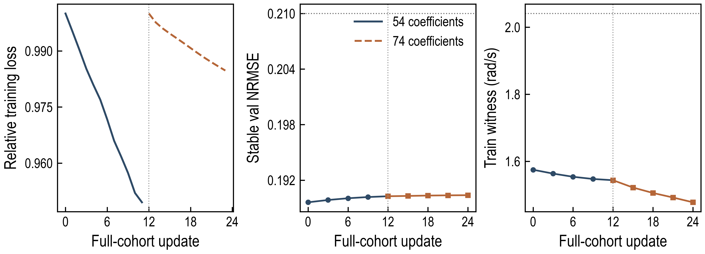

# M3 统一结构发现与 74 维闭环拟合结果

[返回主题页](../README.md)

## 运行结果与归档

- [运行结果](../../../../results/unified_discovery_m3_v1-discovery-20261120T080201366232Z-dc27983e-6970d859)

登记文件与配置

[方案](../../../../configs/experiments/unified_discovery_m3_v1.toml)

## 执行协议

### M3 统一结构发现与 74 维闭环拟合

在同一十机显式方程中检验逐边刚度、基础阻尼和记忆端口的联合调整，以及五个候选物理模块对首摆和长时轨迹的影响。使用冻结的 `train=346`（311 个稳定、35 个失稳）和 `val=107`（95 个稳定、12 个失稳）来源限定名单。一次正式执行，`test` 轨迹读取上限为 0。[冻结名单](../../../../configs/proposals/kiki_task3_split_reference_v1.json) · [V4 拟合回执](../m1_v4/_sealed/unified_first_swing_v4_fit_20261119_evidence.json)

#### 共同方程和因果初态

用 A06 冻结方程的 45 条正边刚度和原 9 个欧氏零和阻尼系数作为锚点。刚度和阻尼各系数在锚点倍数 \([0.5,2]\) 内独立调整。用 V4 第 0 步冻结模型的十个记忆端口和十个记忆时间常数作为起点，保持 \(g_i\ge 0.01\) 和 \(0.02\le\tau_i\le 5\) 秒。阻尼基函数用于非负系数的谱组合。在逐机功角阻尼开启时，耗散矩阵仍满足 \(D(q)\succeq(1-\rho)D_0\succeq0\)。

沿用 `measured_history_100ms_zoh_v1`。每个事件只有故障清除后 11 帧的质心相对功角和转速、参考平衡点、惯量和图先验进入初始化。固定先验为 \(10^{-6}\)，用原软 \(2R\) 映射进行五次 GN，估计十个记忆坐标。活跃拓扑状态在第一个历史帧置零并随方程演化，起报点重置可见状态并传递全部隐态。未来机械功率采用起报点零阶保持。标签、有效窗口和未来轨迹用于损失或评分。

| 模块 | 被估计的系数 | 约束与删除方式 |
| --- | --- | --- |
| G1 二阶谐波 | \(a\) | \([0,0.6]\)，由移位势能生成，删除后保持一阶恢复力 |
| G2 逐机功角阻尼 | \(\rho\) | \([0,0.85]\)，删除后保留固定基础耗散矩阵 |
| G3 整体动态耦合 | \(\mu_c\) | \([0,0.5]\)，标量状态按梯度流演化，\(\kappa_c=1\)，删除整个状态与系数 |
| G4 空间动态耦合 | \(\mu_\xi,\kappa_\xi\) | \([0,0.5]\) 与 \([0.05,1]\)，空间对数调制零和，删除整个九维状态和两个系数 |
| G5 饱和端口 | \(\gamma_s\) | \([0,8]\)，两侧共用 \(1/(1+\gamma_s s_i(q))\)，删除后恢复常端口 |

整体与空间调制共享八阶平滑比例，使每条动态刚度相对于自身拟合后的基准刚度处于 \([1/4,2]\)。空间部分保持零和，实际可达范围随耦合方向而变。两种拓扑状态分别沿同一势能的负梯度移动。移位势能、耗散矩阵、记忆互易端口和状态松弛共同给出带输入的 \(\dot H\le v^\top p\)。结论只覆盖故障后方程。

#### 串行执行

1. **合成前置检查。** 使用合成状态检验全 32 个支持的完整储能收支，归一化残差低于 \(10^{-12}\)，并核对阻尼半正定性、端口下界、离散步长一致性和删除退化。全开时逐项有限差分核对全部 74 个基础坐标，检验导数穿过软半径 GN 后进入闭环轨迹。CUDA 数值检查必须通过，真实轨迹读取为 0。
2. **弱动量初筛。** 冻结 74 个共有系数，以五个候选均关闭的方程为参照。对每个模块用登记的正值网格与一个局部坐标精化步骤搜索。精化测试最优网格点与每轴相邻点的中点，并从所有合格点中选取目标最小者。各组残差基于起报后 0–200 ms 与 200–400 ms 中可完整评分的窗口。每个事件先平均可用窗口的归一化速度增量平方残差，再按事件等权取组均方根。优化目标用稳定事件权重 1、失稳事件权重 8 的平方残差，并等权平均两档步长。任一档在最佳搜索点上比参照恶化超过 2%（失稳）或 5%（稳定）即筛除，另列窗口缺失和数值失败。保留全部尝试及分组残差。
3. **54 至 74 维课程。** 始终使用 G2 参照 \(\rho=2/3\)。先在 12 次全量更新内开放 45 个边刚度和 9 个基础阻尼，记忆维持 V4 起点。再从第一个阶段选中点出发开放记忆，在 12 次全量更新内让骨架以 \(2\times10^{-4}\)、记忆以 \(10^{-3}\) 同时更新。每 3 步检查全 `val` 和 33 个 `train` 见证，保存各步损失、选中参数、45 边变化分布和变化最大的十条边。第二阶段选中点写入 `backbone_74d.npz`。
4. **闭环删块。** 从 `backbone_74d.npz` 和筛选的模块起点重建所有幸存模块。在同一基础快照上为全支持和每个待删支持各做 15 次全量更新，基础系数学习率 \(2\times10^{-4}\)，模块系数学习率 \(10^{-3}\)。每次更新按新方程重算全部因果 GN。每 3 步检查全 `val` 与原见证。若某个单块删除后通过正式门且与合格父支持等价，沿最佳删除继续。若父支持未过门且一个子支持正式过门，继续检查该子支持；若没有合格删除，停止。最多拟合 16 个不同支持。课程中的固定 G2 模型作为独立参照纳入最终比较。

训练以 64 例为一批，在固定顺序中累加完整 `train` 的梯度。训练 RK4 步长 5 ms，正式筛选、检查和评分均用 CUDA float64 的 2.5 ms 与 1.25 ms。稳定事件的 1 秒和 3 秒轨迹使用转折点为 1 的 Huber，失稳事件使用平方误差。首摆项为弱动量加半权单边转速项，失稳事件首摆权重为 8。每个拟合起点将首摆有效梯度范数定为轨迹梯度的 1.05 倍。综合目标使用系数为 1 的锚点平方惩罚和系数为 0.1 的起报记忆储能软惩罚。骨架正则始终围绕 A06 的对数坐标，课程记忆围绕 V4，删块记忆与模块分别围绕已冻结的 74 维骨架和筛选起点。梯度裁剪为 1。若拟合出现数值失败，记录停止位置，并将该支持留在诊断表。完整评分中每个数值失败批最多逐例隔离一次。

#### 选点与最终门槛

两档步长分别完整核验。正式资格要求 `train` 和 `val` 数值合格且无未覆盖，`val` 零未决、检出 12/12、稳定误报最多 1 个。`val` 全部 95 个真实稳定事件的 8 秒 NRMSE 中位数至多 0.21，真阴性 8 秒均值至多 0.24，并报告全体均值及真阴性分母。全部 33 个原 `train` 见证的带符号残差中位数距零至少缩小 20%，绝对残差中位数严格低于原硬球基线。双步长基线来自冻结回执，主步长的两个参照值为 2.55102 和 2.62025 rad/s。允许 2 个误报的情况只作宽松诊断，列入排序而不通过正式门。

检查点依次优先正式过门、宽松诊断过门、数值与指标完整、其他。档内从数值失败和未覆盖数、检出数、未决数、误报数、`val` 峰值正欠估中位数、见证中位数距零、稳定中位数、真阴性均值比较。检出数取高值，其余取低值，连续指标使用较差步长，完全并列保留较早点。各候选选中点另作全 `train/val` 双步长评分。两个过门支持之间，若删掉一个模块后两档下的稳定中位数、真阴性均值和峰值正欠估各自恶化均不超过 2%，优先较少模块。若无正式合格支持，冻结排序第一的诊断快照并记录 `KEEP_BASELINE`。其余情况冻结唯一选中支持，部署基线由后续审查决定。

本次最多 264 次共享参数更新、106 次拟合期间的完整 `val` 检查，另最多复评 17 个候选的完整 `train/val`。筛选最多 42 个配置。首次真实执行最多打开一次静态和两次开发缓存。访问和计算分别登记到账本。输出 `screening_table.json`、课程日志、`pruning_table.json`、全名单评分、33 个见证和 `freeze_m3.npz`。`test` 轨迹读取为 0，独立后续分析需要各自的范围。[执行配置](../../../../configs/experiments/unified_discovery_m3_v1.toml) · [单一入口](../../../../scripts/run_unified_discovery_m3.py)

## 报告与结果

### M3 统一结构发现与 74 维闭环拟合结果

联合验收判定 **KEEP_BASELINE**。排序第一的 **G2** 保存为诊断快照。课程两段分别完成 12/12 和 12/12 次全量更新，后向剪枝拟合 6 个支持。本轮累计做了 114 次全量更新和 46 次拟合期间的完整检查。所有正式评分使用来源限定的 `train=346` 和 `val=107`。`test` 轨迹读取为 0。[预登记协议](#doc-01e5c5b602aa) · [SHA256 回执](_sealed/unified_discovery_m3_v1_20261120_evidence.json)

#### 数值检查与数据范围

合成回归覆盖 32 种候选组合、74 个基础坐标的有限差分、阻尼半正定性、端口下界和双步长一致性。合成阶段真实数据读取为 0。所有正式评分使用 CUDA float64 和 2.5 ms、1.25 ms 两档步长。计算依据和实际运行环境已登记。[SHA256 回执](_sealed/unified_discovery_m3_v1_20261120_evidence.json)

#### 弱动量初筛

相对变化为最佳搜索点相对五个模块均关闭的参照。在同一格内依次给出 2.5 ms 和 1.25 ms。

| 模块 | 最佳搜索系数 | 稳定组 RMS 变化 | 失稳组 RMS 变化 | 判定 |
| --- | --- | ---: | ---: | --- |
| G1 | `a=0.02` | -0.26% / -0.26% | +1.51% / +1.51% | RETAINED |
| G2 | `rho=0.85` | -7.33% / -7.33% | -37.54% / -37.54% | RETAINED |
| G3 | `mu_c=0.15` | +0.34% / +0.34% | -5.97% / -5.97% | RETAINED |
| G4 | `mu_xi=0.015`, `kappa_xi=0.05` | -0.42% / -0.42% | +0.14% / +0.14% | RETAINED |
| G5 | `gamma_s=1.5` | -3.91% / -3.91% | -8.70% / -8.70% | RETAINED |

2.5 ms 参照中，稳定组两个窗口分别覆盖 311/311 和 311/311，失稳组分别覆盖 26/35 和 14/35。组 RMS 分别为 0.64476 和 1.57364。

1.25 ms 参照中，稳定组两个窗口分别覆盖 311/311 和 311/311，失稳组分别覆盖 26/35 和 14/35。组 RMS 分别为 0.64476 和 1.57364。

全部搜索点见[初筛表](../../../../results/unified_discovery_m3_v1-discovery-20261120T080201366232Z-dc27983e-6970d859/screening_table.json)。

#### 课程学习与 45 条边变化

54 维和 74 维分别选中第 **12** 和 **0** 步。曲线在两段内各自把初始训练目标归一为 1，阶段切换以第一段的选中点起步。中图为 `val` 全部真实稳定样本的 8 秒 NRMSE 中位数。右图为 `train` 见证带符号残差中位数的绝对值。两图均用 2.5 ms 主步长，水平虚线为门槛。

| 课程阶段 | 记录时点 | 45 边绝对变化中位数 | 最大绝对变化 | Top-10 涉及索引 9 |
| --- | --- | ---: | ---: | ---: |
| 2a | 最后检查第 12 步 | +0.12% | +1.22% | 5/10 |
| 2a | 选中第 12 步 | +0.12% | +1.22% | 5/10 |
| 2b | 最后检查第 12 步 | +0.34% | +1.44% | 6/10 |
| 2b | 选中第 0 步 | +0.12% | +1.22% | 5/10 |

下表按最后一次检查的绝对相对变化排序。机组编号采用从 0 起的索引，边的符号表示相对 A06 锚点的方向。

| 名次 | 2a 边端点 | 2a 相对变化 | 2b 边端点 | 2b 相对变化 |
| ---: | --- | ---: | --- | ---: |
| 1 | 2–7 | +1.22% | 4–9 | -1.44% |
| 2 | 4–9 | -1.22% | 2–7 | +1.43% |
| 3 | 1–9 | -1.22% | 2–9 | -1.43% |
| 4 | 2–9 | -1.21% | 0–1 | +1.42% |
| 5 | 4–7 | +1.19% | 0–5 | +1.41% |
| 6 | 6–9 | -1.19% | 1–9 | -1.40% |
| 7 | 0–1 | +1.18% | 0–9 | -1.34% |
| 8 | 3–9 | -1.17% | 6–9 | -1.31% |
| 9 | 2–5 | +1.17% | 0–2 | +1.30% |
| 10 | 0–5 | +1.17% | 3–9 | -1.19% |

| 课程阶段 | 起点轨迹梯度范数 | 起点首摆梯度范数 | 定标系数 | 两项梯度夹角余弦 |
| --- | ---: | ---: | ---: | ---: |
| 2a | 0.44093 | 3.50069 | 0.13225 | 0.52187 |
| 2b | 0.67231 | 2.95220 | 0.23912 | -0.23244 |

[课程信息和选中系数](../../../../results/unified_discovery_m3_v1-discovery-20261120T080201366232Z-dc27983e-6970d859/curriculum.json) · [2a 逐步损失](../../../../results/unified_discovery_m3_v1-discovery-20261120T080201366232Z-dc27983e-6970d859/curriculum_2a/training.jsonl) · [2b 逐步损失](../../../../results/unified_discovery_m3_v1-discovery-20261120T080201366232Z-dc27983e-6970d859/curriculum_2b/training.jsonl)

#### 支持重拟合与后向剪枝

表列候选选中点的主步长数值，门的判定使用两档步长和完整 `train/val`。

| 支持 | 完成 / 选中步 | `val` TP / FP / 未决 | 稳定 NRMSE 中位数 | TN 均值 | 峰值正欠估 rad/s | 见证残差 rad/s | 未通过的门 |
| --- | ---: | ---: | ---: | ---: | ---: | ---: | --- |
| backbone_74d | 12 / 0 | 12 / 2 / 0 | 0.19026 | 0.21494 | 0.44088 | 1.54355 | 稳定误报 |
| support-G1-G2-G3-G4-G5 | 15 / 15 | 11 / 0 / 0 | 0.23167 | 0.32571 | 1.33414 | 2.98631 | 失稳检出、稳定轨迹、首摆见证 |
| support-G2-G3-G4-G5 | 15 / 0 | 11 / 0 / 0 | 0.22909 | 0.32773 | 1.33951 | 2.89752 | 失稳检出、稳定轨迹、首摆见证 |
| support-G1-G3-G4-G5 | 15 / 9 | 8 / 0 / 1 | 0.22990 | 0.31211 | 2.39380 | 6.05662 | 数值与覆盖、失稳检出、稳定轨迹、首摆见证 |
| support-G1-G2-G4-G5 | 15 / 3 | 11 / 2 / 0 | 0.19163 | 0.22409 | 0.21249 | 0.52587 | 失稳检出、稳定误报 |
| support-G1-G2-G3-G5 | 15 / 15 | 11 / 0 / 0 | 0.23144 | 0.32516 | 1.33383 | 2.98711 | 失稳检出、稳定轨迹、首摆见证 |
| support-G1-G2-G3-G4 | 15 / 0 | 12 / 1 / 0 | 0.23828 | 0.33194 | 0.76758 | 2.03326 | 数值与覆盖、稳定轨迹、首摆见证 |

排序第一的快照在主步长检出 `val` 的 12/12 例失稳，33 个见证带符号残差中位数距零降幅为 39.49%。正式门槛未通过的项目为稳定误报。

74 维阶段各检查点均在 `val` 检出 12/12 例失稳并误报 2 例。第 12 步的 `train` 见证残差降至 1.47766 rad/s，`val` 峰值正欠估中位数由 0.44088 升至 0.46034 rad/s。预登记排序优先比较峰值欠估，选中第 0 步，沿用 54 维阶段的选中点。因此 `backbone_74d.npz` 中的记忆参数仍为 V4 起点。

关闭 G5 后，选中点在两档步长均检出 `val` 的 12/12 例失稳，稳定误报 1 个。稳定轨迹 8 秒 NRMSE 中位数为 0.23828，真阴性均值为 0.33194，33 个见证绝对残差中位数为 3.09301 rad/s。该组的 `train` 事件 `ieee39_expansion/expansion_0062` 的 8 秒轨迹两步长一致性检查未通过，分类检查合格。

自动剪枝路径为 `support-G1-G2-G3-G4-G5`。[逐次删除和等价带比较](../../../../results/unified_discovery_m3_v1-discovery-20261120T080201366232Z-dc27983e-6970d859/pruning_table.json)

#### 冻结快照完整评分

选中快照的记忆端口最小幅值为 0.72067。两档下 `train` 的起报记忆储能最大值为 74.98615 / 74.98615，`val` 为 74.87388 / 74.87388。

| 名单 | 步长 ms | TP / TN / FP / FN | 未决 | 数值失败 / 未覆盖 | 全名单准确率 | 可判定准确率 / 覆盖率 | 失稳召回 / 漏判 / 稳定误报率 |
| --- | ---: | ---: | ---: | ---: | ---: | ---: | ---: |
| `train` | 2.5 | 33 / 304 / 7 / 1 | 1 | 0 / 0 | — | 97.68% / 99.71% | 97.06% / 2.94% / 2.25% |
| `train` | 1.25 | 33 / 304 / 7 / 1 | 1 | 0 / 0 | — | 97.68% / 99.71% | 97.06% / 2.94% / 2.25% |
| `val` | 2.5 | 12 / 93 / 2 / 0 | 0 | 0 / 0 | 98.13% | 98.13% / 100.00% | 100.00% / 0.00% / 2.11% |
| `val` | 1.25 | 12 / 93 / 2 / 0 | 0 | 0 / 0 | 98.13% | 98.13% / 100.00% | 100.00% / 0.00% / 2.11% |

表中召回率、漏判率与误报率的分母为对应的可判定事件。未决、未覆盖或数值失败出现时，全名单准确率记为空。
稳定轨迹 NRMSE 为事件等权均值。失稳轨迹使用真实序列可用的起报后时段。

| 名单 | 步长 ms | 稳定 1 / 2 / 5 s NRMSE | 稳定 8 s 均值 / 中位数 / TN 均值 | 失稳 NRMSE 均值 | 500 ms 峰值正欠估 rad/s | TASK3 综合评分 |
| --- | ---: | ---: | ---: | ---: | ---: | ---: |
| `train` | 2.5 | 0.34369 / 0.39763 / 0.60099 | 0.88531 / 0.18496 / 0.20915 | 0.76926 | 0.44618 | 0.63207 |
| `train` | 1.25 | 0.34369 / 0.39763 / 0.60099 | 0.88531 / 0.18496 / 0.20915 | 0.76926 | 0.44618 | 0.63207 |
| `val` | 2.5 | 0.31876 / 0.32908 / 0.35539 | 0.43838 / 0.19026 / 0.21494 | 0.66846 | 0.44088 | 0.48635 |
| `val` | 1.25 | 0.31876 / 0.32908 / 0.35539 | 0.43838 / 0.19026 / 0.21494 | 0.66846 | 0.44088 | 0.48635 |

主步长下 `val` 稳定误报事件及其 8 s NRMSE 为 `ieee39_postfault/pilot_0150`（18.97570）、`ieee39_postfault/pilot_0237`（2.68069）。

[逐例 train 轨迹评分与分类](../../../../results/unified_discovery_m3_v1-discovery-20261120T080201366232Z-dc27983e-6970d859/curriculum_2b/train.json) · [逐例 val 轨迹评分与分类](../../../../results/unified_discovery_m3_v1-discovery-20261120T080201366232Z-dc27983e-6970d859/curriculum_2b/val.json)

##### 33 个固定见证

见证从同一因果初态出发，沿观测轨迹积分至见证末端。正残差表示方程解释的分离速度增量偏小。

| 来源限定事件 | 分离机组（高–低） | 起报后时长 s | 2.5 ms 残差 rad/s | 1.25 ms 残差 rad/s |
| --- | --- | ---: | ---: | ---: |
| `ieee39_expansion/expansion_0008` | 2–9 | 0.36 | 1.02262 | 1.02262 |
| `ieee39_expansion/expansion_0010` | 2–9 | 0.09 | 1.54355 | 1.54355 |
| `ieee39_expansion/expansion_0013` | 2–9 | 0.21 | 0.83155 | 0.83155 |
| `ieee39_expansion/expansion_0030` | 2–9 | 0.20 | 0.99279 | 0.99279 |
| `ieee39_expansion/expansion_0044` | 2–9 | 0.56 | 3.05091 | 3.05091 |
| `ieee39_expansion/expansion_0078` | 8–9 | 0.25 | 4.65283 | 4.65283 |
| `ieee39_expansion/expansion_0104` | 1–9 | 0.33 | 2.87625 | 2.87625 |
| `ieee39_expansion/expansion_0109` | 1–9 | 0.08 | 0.82056 | 0.82056 |
| `ieee39_expansion/expansion_0118` | 2–9 | 0.59 | 3.64068 | 3.64068 |
| `ieee39_expansion/expansion_0120` | 2–9 | 0.14 | 0.99635 | 0.99635 |
| `ieee39_expansion/expansion_0123` | 2–9 | 0.29 | 1.89900 | 1.89900 |
| `ieee39_expansion/expansion_0138` | 4–9 | 1.28 | 2.51065 | 2.51065 |
| `ieee39_expansion/expansion_0143` | 3–9 | 0.21 | 3.47558 | 3.47558 |
| `ieee39_postfault/pilot_0030` | 1–9 | 0.51 | -4.94194 | -4.94194 |
| `ieee39_postfault/pilot_0044` | 2–9 | 0.87 | 0.73560 | 0.73560 |
| `ieee39_postfault/pilot_0072` | 1–9 | 0.42 | 2.59836 | 2.59836 |
| `ieee39_postfault/pilot_0077` | 1–9 | 0.30 | 1.19488 | 1.19488 |
| `ieee39_postfault/pilot_0093` | 1–9 | 0.21 | 1.12333 | 1.12333 |
| `ieee39_postfault/pilot_0122` | 1–9 | 0.35 | 1.75697 | 1.75697 |
| `ieee39_postfault/pilot_0174` | 2–9 | 0.34 | 0.60326 | 0.60326 |
| `ieee39_postfault/pilot_0202` | 2–9 | 0.34 | 0.16383 | 0.16383 |
| `ieee39_postfault/pilot_0205` | 2–0 | 1.44 | 0.74172 | 0.74172 |
| `ieee39_postfault/pilot_0207` | 2–9 | 0.04 | 0.11101 | 0.11101 |
| `ieee39_postfault/pilot_0220` | 2–9 | 1.21 | -3.30366 | -3.30366 |
| `ieee39_postfault/pilot_0222` | 2–9 | 0.09 | -0.93022 | -0.93022 |
| `ieee39_postfault/pilot_0252` | 2–9 | 0.67 | 1.69464 | 1.69464 |
| `ieee39_postfault/pilot_0280` | 4–9 | 0.99 | 7.51598 | 7.51598 |
| `ieee39_postfault/pilot_0282` | 4–9 | 0.41 | 3.09295 | 3.09295 |
| `ieee39_postfault/pilot_0285` | 4–9 | 0.40 | 2.92867 | 2.92867 |
| `ieee39_postfault/pilot_0300` | 2–9 | 0.73 | 3.20529 | 3.20529 |
| `ieee39_postfault/pilot_0303` | 2–8 | 1.61 | 6.69723 | 6.69723 |
| `ieee39_postfault/pilot_0335` | 6–9 | 0.14 | 1.90227 | 1.90227 |
| `ieee39_postfault/pilot_0380` | 8–9 | 0.09 | 0.99120 | 0.99120 |
| 带符号中位数 |  |  | 1.54355 | 1.54355 |
| 绝对残差中位数 |  |  | 1.75697 | 1.75697 |
| 原硬半径带符号中位数 |  |  | 2.55102 | 2.55102 |
| 原硬半径绝对残差中位数 |  |  | 2.62025 | 2.62025 |
| 带符号中位数距零降幅 |  |  | +39.49% | +39.49% |

[冻结参数](../../../../results/unified_discovery_m3_v1-discovery-20261120T080201366232Z-dc27983e-6970d859/freeze_m3.npz) · [冻结合同](../../../../results/unified_discovery_m3_v1-discovery-20261120T080201366232Z-dc27983e-6970d859/freeze.json) · [访问账本](../../../../results/unified_discovery_m3_v1-discovery-20261120T080201366232Z-dc27983e-6970d859/access.jsonl) · [操作账本](../../../../results/unified_discovery_m3_v1-discovery-20261120T080201366232Z-dc27983e-6970d859/operations.jsonl)

## 回执与附件

- [curriculum_20261120.png](_sealed/figures/curriculum_20261120.png)
- [curriculum_20261120.svg](_sealed/figures/curriculum_20261120.svg)
- [unified_discovery_m3_v1_20261120_evidence.json](_sealed/unified_discovery_m3_v1_20261120_evidence.json)

原件与版本

- [docs/protocols/unified_discovery_m3_v1_zh.md](_sealed/unified_discovery_m3_v1_zh.md)
- [docs/reports/05_research_governance/_sealed/docs/protocols/unified_discovery_m3_v1_zh.md](_sealed/original/unified_discovery_m3_v1_zh.md)
- [docs/reports/10_postfault_structure/_sealed/unified_discovery_m3_v1_20261120_zh.md](_sealed/original/unified_discovery_m3_v1_20261120_zh.md)
- [docs/reports/10_postfault_structure/unified_discovery_m3_v1_20261120_zh.md](_sealed/unified_discovery_m3_v1_20261120_zh.md)

