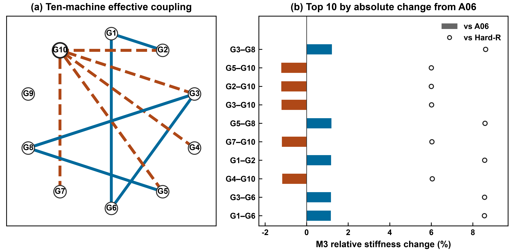
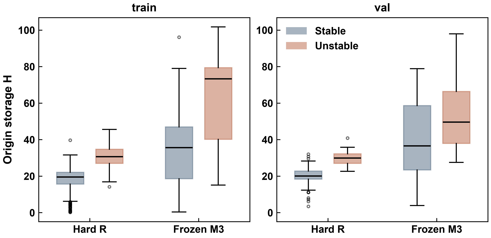

# 冻结十机模型的故障后物理一致性

[返回主题页](../README.md)

## 运行结果与归档

- [运行结果（归档）](../../../../results/backup/10_postfault_structure/06_m3b_frozen_evaluation.DESCRIPTION.md#run-1)
- [运行结果（归档）](../../../../results/backup/10_postfault_structure/06_m3b_frozen_evaluation.DESCRIPTION.md#run-2)
- [运行结果（包内 `summary.json`）](../../../../results/backup/10_postfault_structure/07_m4_physical_consistency.DESCRIPTION.md#run-1)

登记文件与配置

[执行配置](../../../../configs/experiments/postfault_m4_m3b_v1.toml) · [工作流登记](../../../../configs/workflows/unified_discovery_m3b_test_v1.json)

## 执行协议

### M4 故障后物理一致性与 M3b 三组配对拟合

使用冻结的 TASK3 名单和 `measured_history_100ms_zoh_v1`。模型起报输入为故障清除后 11 帧功角和转速以及固定先验，未来机械功率在起报点做零阶保持。M4 比较冻结 M3 G2 与 V4 原硬半径模型。M3b 完成三组新拟合与冻结。M3 的 `KEEP_BASELINE` 保留为历史结果。

#### M4 零训练物理对照

读取按 SHA256 封存的 V4 和 M3 `train/val` 预测、真值及初态统计。原始轨迹缓存打开次数为 0。两个模型使用 A06 方程骨架及各自的有效参数。使用两档已归档预测分析割集与储能。

1. 在共同参考平衡点和零投影扰动输入处构造 28 维解析雅可比，去除两个刚体坐标。与运行时切线及自动微分核对。对 95 个 `val` 稳定事件的相对转速做块 Hankel 移位辨识。主窗起报后 0.5–8 秒，敏感性窗 1.5–8 秒。采样 10 ms，20 个延迟块间隔 20 ms，移位 10 ms，截断秩 6、10、14。经验振荡需在 0.35–3 Hz 内，至少 2 个周期，阻尼比在 0–0.40 内，相对强度至少 5%。两窗秩稳定要求频率差不超过 8%、阻尼比差不超过 0.05、模态保证准则（MAC）至少 0.80。两个模型分别做一对一频率与振型匹配，预筛为 25% 与 MAC 0.50，强对应同时要求 10%、0.05 和 MAC 0.80。报告匹配分母，实测衰减对应数据条件下的有效阻尼。[ERA 方法来源](https://ntrs.nasa.gov/citations/19850064186)
2. 在十机有效耦合图上构造 45 边加权拉普拉斯，用 Fiedler 向量二分。实测参照使用 `val` 稳定事件起报后 6–8 秒的相对转速，逐事件去均值和幅度归一后等权累积两两距离。分别给出与实测分群及 G10–其余九机分区的配对一致率和调整兰德指数。画出相对 A06 变化最大的十条边，另列硬半径对照。
3. 在全部 47 个 `train/val` 失稳事件中，真值和预测各自在 TASK3 首次持续失步时刻依据功角最大相邻间隔划分机组。角度较大的一侧为领先机组。报告触发覆盖、割集和领先集合的精确匹配率以及 Jaccard 相似度。起报储能按归档的因果隐态能量、可见动能和冻结势能计算，按原标签分别报告总量及各分量的 `train/val` AUROC 与四分位数。

#### M3b 范围与选模

失稳组弱动量 RMS 须在两档步长下均比 M3 参照改善。规则使用原初筛表，零新增初筛求解。依次拟合 `{G2,G3,G5}`、`{G2,G5}`、`{G2}`，从同一 `backbone_54d.npz` 和 G2 强度 2/3 开始。G3 与 G5 沿用原筛选起点。每次全量更新重算因果软 2R GN，固定先验 1e-6，执行五次 GN。每组最多 6 次更新，步 0、3、6 检查完整 `val=107` 和 33 个 `train` 见证。对各组选中点再评完整 `train=346` 和 `val=107`。总限额为 3 次拟合、18 次更新、9 次拟合期间检查。基础 74 个参数学习率 0.0002，模块参数 0.001。沿用 M3 稳健轨迹损失、1.05 梯度比例、首摆项、锚点与记忆储能软惩罚。训练用 5 ms，正式评分用 2.5 ms 和 1.25 ms CUDA float64。

正式资格沿用 M3 的数值与覆盖、失稳检出、稳定误报、稳定轨迹、见证残差五项门槛。稳定误报放宽为 **最多 2/95（2.11%）**，排位优先误报少。要求 `val` 12/12 且零未决，完整 `train` 两档均至少检出 33/35。稳定 8 秒真实稳定事件中位数至多 0.21，真阴性均值至多 0.24，见证带符号中位数距零缩小至少 20% 且绝对残差中位数小于原硬半径。组内按 M3 顺序选点，完整 `train` 评分审查资格。G3 组作为删块对照。最终在 `{G2,G5}` 和 `{G2}` 中选。两个过门且误报数相同的候选，若删 G5 后两档稳定中位数、真阴性均值和起报后 500 ms 峰值正欠估各自恶化不超过 2%，保留简约支持。

两组均未过门时，记录 `KEEP_BASELINE` 并冻结排名第一的诊断快照。有过门赢家时，在锁定支持、参数、评估合同及 SHA256 后独立登记一次已曝光的固定 `test=76`。用两档 TASK3 流程评分，与已归档 V4 指标并列报告。结果只用于固定名单对照。M4 和拟合阶段的 `test` 读取上限为 0。[M3 协议](../m3/README.md#doc-01e5c5b602aa)

## 报告与结果

### 冻结十机模型的故障后物理一致性

两份模型在同一批 63 个可配对的 `val` 主模态上，M3 的频率绝对误差中位数由 0.05023 降到 0.03292 Hz。其中 62/63 例的频率误差缩小。比较使用封存的 M3 G2 与 V4 原硬半径模型，全部 `train=346` 和 `val=107` 的原始轨迹缓存读取为 0。[预登记协议](#doc-ed11eeac7c0d) · [SHA256 回执](_sealed/postfault_m4_v1_20261121_evidence.json)

#### 解析谱与观测主模态

在共同参考平衡点和零投影扰动输入处，两份 28 维质心商雅可比的最大特征值实部分别为 -0.661759 和 -0.662039 s⁻¹。解析矩阵与运行时自动微分的最大差均小于 1.5×10⁻¹⁴，与切线方程的最大差小于 3×10⁻¹⁴。95 例稳定 `val` 事件中，66 例取得通过双窗和多秩检查的振荡，共 86 个事件模态。其中 0.5–0.8 Hz 有 60 个，1–2 Hz 有 19 个。

| 模型 | 配对主模态 | 频率绝对误差 Hz | 相对频率误差 | 绝对阻尼比误差 | MAC | 强匹配 / 95 |
| --- | ---: | ---: | ---: | ---: | ---: | ---: |
| 原硬 R | 63 | 0.05023 | 7.57% | 0.01006 | 0.94727 | 53/95 |
| 冻结 M3 G2 | 63 | 0.03292 | 4.95% | 0.01362 | 0.94532 | 58/95 |

表中误差与 MAC 使用两模型共同匹配的主模态。强匹配以全部 95 个稳定事件为分母。两个模型在同一参考点线性化。G2 的功角软化在该点消失，线性耗散使用各自的基础阻尼。观测衰减反映该事件条件下的有效阻尼。

| 模型 | 频带内解析共轭极点（频率 Hz，阻尼比） |
| --- | --- |
| 原硬 R | (0.613, 0.196)，(0.673, 0.283)，(0.843, 0.199)，(0.853, 0.412)，(1.002, 0.380)，(1.125, 0.288)，(1.263, 0.219)，(1.430, 0.199) |
| 冻结 M3 G2 | (0.463, 0.912)，(0.632, 0.179)，(0.695, 0.258)，(0.871, 0.188)，(0.900, 0.364)，(1.051, 0.344)，(1.170, 0.259)，(1.316, 0.199)，(1.486, 0.179) |

[两份完整雅可比、全部特征值和逐例匹配（包内 `modes.json`）](../../../../results/backup/10_postfault_structure/07_m4_physical_consistency.DESCRIPTION.md#run-1)

#### 45 条边刚度与机组同调

相对 A06 的变化前十中，G10 的 5 条联络边均软化，其余五条均刚化。在 G10 的九条边中有七条软化。原硬 R 的 45 条边相对 A06 统一降低 6.81%。以原硬 R 为参照时，M3 的 45 条边增幅为 6.00%–8.61%。图上只绘制十条变化最大的有效耦合边。

95/95 例稳定 `val` 的尾段同调参照为 G10 与其余九台。A06、原硬 R 和 M3 的 Fiedler 二分一致，均为 G5、G8、G9 与其余七台。静态分群与实测参照相符的机组对为 21/45，调整兰德指数为 −0.1111。[全 45 边、谱间隙和实测亲和度（包内 `graph.json`）](../../../../results/backup/10_postfault_structure/07_m4_physical_consistency.DESCRIPTION.md#run-1)

#### 领先失步割集与起报储能

两档步长在下表所列触发、精确匹配与 AUROC 上一致。割集匹配同时列出全体真实失稳样本以及模型与真值均触发的样本，分母分别见两列。

| 名单 | 模型 | 真实触发 | 预测触发 | 领先割集精确匹配 / 全部 | 精确匹配 / 双触发 | 双触发割集 Jaccard 均值 |
| --- | --- | ---: | ---: | ---: | ---: | ---: |
| `train` | 原硬 R | 35 | 27 | 24/35 | 24/27 | 0.9412 |
| `train` | 冻结 M3 G2 | 35 | 33 | 29/35 | 29/33 | 0.9133 |
| `val` | 原硬 R | 12 | 11 | 10/12 | 10/11 | 0.9144 |
| `val` | 冻结 M3 G2 | 12 | 12 | 10/12 | 10/12 | 0.8818 |

M3 复现了原硬 R 漏判的 `expansion_0189` 的领先 G7 割集。`pilot_0239` 的领先集合少一台机组，`pilot_0366` 两模型均划错。

| 名单 | 模型 | 总储能 AUROC | 动能 | 势能 | 记忆储能 |
| --- | --- | ---: | ---: | ---: | ---: |
| `train` | 原硬 R | 0.9239 | 0.9689 | 0.8771 | 0.6220 |
| `train` | 冻结 M3 G2 | 0.8089 | 0.9689 | 0.8804 | 0.7084 |
| `val` | 原硬 R | 0.9333 | 0.9386 | 0.8895 | 0.5877 |
| `val` | 冻结 M3 G2 | 0.6702 | 0.9386 | 0.8895 | 0.5623 |

`val` 中，硬 R 和 M3 的总储能 AUROC 分别为 0.9333 和 0.6702，两者的可见动能均为 0.9386。可见动能由起报转速和惯量确定。M3 总储能的两类分布重叠较多。AUROC 衡量这些已标注事件的排序区分度。[逐事件储能、分量四分位和割集（包内 `event_physics.json`）](../../../../results/backup/10_postfault_structure/07_m4_physical_consistency.DESCRIPTION.md#run-1)

箱线图使用 2.5 ms 归档隐态。`train` 有 311 稳定和 35 失稳事件，`val` 有 95 稳定和 12 失稳事件。箱体为四分位范围，须线为 1.5 倍四分位差范围内的观测端点。

M4 沿用已冻结的起报历史与归档预测。共享参数更新、额外自由预测和 `test` 轨迹读取均为 0。

### 固定 TASK3 test 冻结对照

M3b 通过拟合验收后，冻结 `{G2}`，以 2.5 ms 和 1.25 ms 对同一 `test=76` 完成一次预测。冻结 SHA256 由拟合回执和本次独立授权共同绑定。V4 数字来自已保存的冻结评分。此表对应曾曝光的固定名单。

| 模型 | TP / TN / FP / FN | 未决 | 数值失败 | 准确率 | 可判定准确率 / 覆盖率 | 可判定召回 / 漏判 / 误报率 |
| --- | ---: | ---: | ---: | ---: | ---: | ---: |
| V4 原硬 R | 3 / 67 / 0 / 4 | 2 | 0 | — | 94.59% / 97.37% | 42.86% / 57.14% / 0.00% |
| V4 软 2R | 6 / 67 / 0 / 1 | 2 | 0 | — | 98.65% / 97.37% | 85.71% / 14.29% / 0.00% |
| M3b 冻结赢家 | 5 / 67 / 0 / 2 | 2 | 0 | — | 97.30% / 97.37% | 71.43% / 28.57% / 0.00% |

| 模型 | 稳定 1 / 2 / 5 / 8 秒 NRMSE 均值 | 稳定 8 秒中位数 | 真阴性 8 秒均值 | 失稳实际区间 NRMSE 均值 | TASK3 综合评分 |
| --- | ---: | ---: | ---: | ---: | ---: |
| V4 原硬 R | 0.29395 / 0.24672 / 0.20933 / 0.18779 | 0.15899 | 0.18779 | 1.01852 | 0.41890 |
| V4 软 2R | 0.34540 / 0.29460 / 0.23698 / 0.20786 | 0.17583 | 0.20786 | 1.38176 | 0.50395 |
| M3b 冻结赢家 | 0.33688 / 0.28741 / 0.22967 / 0.20083 | 0.16735 | 0.20083 | 1.37321 | 0.49751 |

相对 V4 软 2R，分类发生变化的固定名单事件为 `ieee39_holdout_supplement/holdout_0019`（失稳 → 稳定）。

M3b 观察到 5/9 个确认失稳、2 个漏判、2 个未决和 0 个稳定误报。两档轨迹与分类的数值资格检查结果为全部通过。

[全名单逐例评分（包内 `test.json`）](../../../../results/backup/10_postfault_structure/06_m3b_frozen_evaluation.DESCRIPTION.md#run-2) · [数值与两档预测（包内 `test_predictions.npz`）](../../../../results/backup/10_postfault_structure/06_m3b_frozen_evaluation.DESCRIPTION.md#run-2) · [SHA256 回执](_sealed/unified_discovery_m3b_test_v1_20261121_evidence.json)

### M3b 同一骨架的三组短程拟合

三组从 M3 54 维课程选中点出发，均采用软 2R 初态。`{G2}` 排名第一并冻结，通过全部验收条件。全程执行 18 次全量更新和 9 次拟合期间完整 `val` 检查。[预登记协议](#doc-ed11eeac7c0d) · [SHA256 回执](_sealed/unified_discovery_m3b_v1_20261121_evidence.json)

单 G2 的三个检查点分类一致。起报后 500 ms 的峰值正欠估中位数为 0.44088、0.44380 和 0.44606 rad/s，按登记顺序保留第 0 步。冻结参数与 M3 的 54 维选中点及 M3 诊断快照逐字节相同。正式资格来自预登记的误报上限由 1 调至 2。

#### 初筛和支持比较

| 模块 | 2.5 ms 失稳 RMS 变化 | 1.25 ms 失稳 RMS 变化 | 是否保留 |
| --- | ---: | ---: | --- |
| G1 | +1.51% | +1.51% | 移除 |
| G2 | -37.54% | -37.54% | 保留 |
| G3 | -5.97% | -5.97% | 保留 |
| G4 | +0.14% | +0.14% | 移除 |
| G5 | -8.70% | -8.70% | 保留 |

下表为选中检查点的 2.5 ms 值。正式门槛按两档评分。

| 支持 | 更新 / 选中 | val 检出 / 误报 / 未决 | train 检出 | val 稳定中位数 / 真阴性均值 | 见证有符号 / 绝对中位数 rad/s | 未通过门槛 |
| --- | ---: | ---: | ---: | ---: | ---: | --- |
| `{G2,G3,G5}` | 6 / 6 | 11/12 / 0 / 0 | 29/35 | 0.22598 / 0.31277 | 3.56411 / 3.63495 | val 失稳检出、稳定轨迹、首摆见证、train 失稳检出 |
| `{G2,G5}` | 6 / 0 | 11/12 / 0 / 0 | 32/35 | 0.19064 / 0.22364 | 1.42920 / 1.99074 | val 失稳检出、train 失稳检出 |
| `{G2}` | 6 / 0 | 12/12 / 2 / 0 | 33/35 | 0.19026 / 0.21494 | 1.54355 / 1.75697 | — |

从 `{G2,G3,G5}` 删除 G3 后未达到登记的闭环删除判据。

从 `{G2,G5}` 删除 G5 后符合登记的闭环删除判据。

[两档逐支持结果与删块判定（包内 `pruning_table.json`）](../../../../results/backup/10_postfault_structure/06_m3b_frozen_evaluation.DESCRIPTION.md#run-1)

#### 逐步检查

| 支持 | 步 | val 检出 / 误报 / 未决 | 峰值正欠估中位数 rad/s | 见证带符号中位数 rad/s |
| --- | ---: | ---: | ---: | ---: |
| `{G2,G3,G5}` | 0 | 11/12 / 0 / 0 | 1.73825 | 3.61316 |
| `{G2,G3,G5}` | 3 | 11/12 / 0 / 0 | 1.72468 | 3.58875 |
| `{G2,G3,G5}` | 6 | 11/12 / 0 / 0 | 1.71125 | 3.56411 |
| `{G2,G5}` | 0 | 11/12 / 0 / 0 | 0.75584 | 1.42920 |
| `{G2,G5}` | 3 | 11/12 / 0 / 0 | 0.77565 | 1.44627 |
| `{G2,G5}` | 6 | 11/12 / 0 / 0 | 0.78743 | 1.45553 |
| `{G2}` | 0 | 12/12 / 2 / 0 | 0.44088 | 1.54355 |
| `{G2}` | 3 | 12/12 / 2 / 0 | 0.44380 | 1.54533 |
| `{G2}` | 6 | 12/12 / 2 / 0 | 0.44606 | 1.54413 |

三组逐步训练损失见 [{G2,G3,G5}（包内 `support-G2-G3-G5/training.jsonl`）](../../../../results/backup/10_postfault_structure/06_m3b_frozen_evaluation.DESCRIPTION.md#run-1) · [{G2,G5}（包内 `support-G2-G5/training.jsonl`）](../../../../results/backup/10_postfault_structure/06_m3b_frozen_evaluation.DESCRIPTION.md#run-1) · [{G2}（包内 `support-G2/training.jsonl`）](../../../../results/backup/10_postfault_structure/06_m3b_frozen_evaluation.DESCRIPTION.md#run-1)。

#### 冻结快照双步长评分

| 名单 | 步长 ms | TP / TN / FP / FN | 未决 | 数值失败 / 未覆盖 | 全名单准确率 | 可判定准确率 / 覆盖率 | 失稳召回 / 漏判 / 误报率（可判定） |
| --- | ---: | ---: | ---: | ---: | ---: | ---: | ---: |
| `train` | 2.5 | 33 / 304 / 7 / 1 | 1 | 0 / 0 | — | 97.68% / 99.71% | 97.06% / 2.94% / 2.25% |
| `train` | 1.25 | 33 / 304 / 7 / 1 | 1 | 0 / 0 | — | 97.68% / 99.71% | 97.06% / 2.94% / 2.25% |
| `val` | 2.5 | 12 / 93 / 2 / 0 | 0 | 0 / 0 | 98.13% | 98.13% / 100.00% | 100.00% / 0.00% / 2.11% |
| `val` | 1.25 | 12 / 93 / 2 / 0 | 0 | 0 / 0 | 98.13% | 98.13% / 100.00% | 100.00% / 0.00% / 2.11% |

| 名单 | 步长 ms | 稳定 1 / 2 / 5 / 8 秒 NRMSE 均值 | 稳定 8 秒中位数 | 真阴性 8 秒均值 | 失稳实际区间 NRMSE 均值 |
| --- | ---: | ---: | ---: | ---: | ---: |
| `train` | 2.5 | 0.34369 / 0.39763 / 0.60099 / 0.88531 | 0.18496 | 0.20915 | 0.76926 |
| `train` | 1.25 | 0.34369 / 0.39763 / 0.60099 / 0.88531 | 0.18496 | 0.20915 | 0.76926 |
| `val` | 2.5 | 0.31876 / 0.32908 / 0.35539 / 0.43838 | 0.19026 | 0.21494 | 0.66846 |
| `val` | 1.25 | 0.31876 / 0.32908 / 0.35539 / 0.43838 | 0.19026 | 0.21494 | 0.66846 |

[完整 train 逐例评分（包内 `support-G2/train.json`）](../../../../results/backup/10_postfault_structure/06_m3b_frozen_evaluation.DESCRIPTION.md#run-1) · [完整 val 逐例评分（包内 `support-G2/val.json`）](../../../../results/backup/10_postfault_structure/06_m3b_frozen_evaluation.DESCRIPTION.md#run-1) · [33 个见证的双步长记录（包内 `support-G2/fit.json`）](../../../../results/backup/10_postfault_structure/06_m3b_frozen_evaluation.DESCRIPTION.md#run-1) · [冻结参数（包内 `freeze_m3b.npz`）](../../../../results/backup/10_postfault_structure/06_m3b_frozen_evaluation.DESCRIPTION.md#run-1) · [冻结评估合同（包内 `freeze.json`）](../../../../results/backup/10_postfault_structure/06_m3b_frozen_evaluation.DESCRIPTION.md#run-1) · [访问账本（包内 `access.jsonl`）](../../../../results/backup/10_postfault_structure/06_m3b_frozen_evaluation.DESCRIPTION.md#run-1) · [计算账本（包内 `operations.jsonl`）](../../../../results/backup/10_postfault_structure/06_m3b_frozen_evaluation.DESCRIPTION.md#run-1)

拟合阶段 `test` 轨迹读取为 0。固定对照另行登记为 `unified_discovery_m3b_test_v1`。

## 回执与附件

- [origin_storage.png](_sealed/figures/origin_storage.png)
- [origin_storage.svg](_sealed/figures/origin_storage.svg)
- [top10_topology.png](_sealed/figures/top10_topology.png)
- [top10_topology.svg](_sealed/figures/top10_topology.svg)
- [postfault_m4_v1_20261121_evidence.json](_sealed/postfault_m4_v1_20261121_evidence.json)
- [unified_discovery_m3b_test_v1_20261121_evidence.json](_sealed/unified_discovery_m3b_test_v1_20261121_evidence.json)
- [unified_discovery_m3b_v1_20261121_evidence.json](_sealed/unified_discovery_m3b_v1_20261121_evidence.json)

原件与版本

- [docs/protocols/postfault_m4_m3b_v1_zh.md](_sealed/postfault_m4_m3b_v1_zh.md)
- [docs/reports/10_postfault_structure/_sealed/postfault_m4_v1_20261121_zh.md](_sealed/original/postfault_m4_v1_20261121_zh.md)
- [docs/reports/10_postfault_structure/_sealed/unified_discovery_m3b_test_v1_20261121_zh.md](_sealed/original/unified_discovery_m3b_test_v1_20261121_zh.md)
- [docs/reports/10_postfault_structure/_sealed/unified_discovery_m3b_v1_20261121_zh.md](_sealed/original/unified_discovery_m3b_v1_20261121_zh.md)
- [docs/reports/10_postfault_structure/postfault_m4_v1_20261121_zh.md](_sealed/postfault_m4_v1_20261121_zh.md)
- [docs/reports/10_postfault_structure/unified_discovery_m3b_test_v1_20261121_zh.md](_sealed/unified_discovery_m3b_test_v1_20261121_zh.md)
- [docs/reports/10_postfault_structure/unified_discovery_m3b_v1_20261121_zh.md](_sealed/unified_discovery_m3b_v1_20261121_zh.md)

