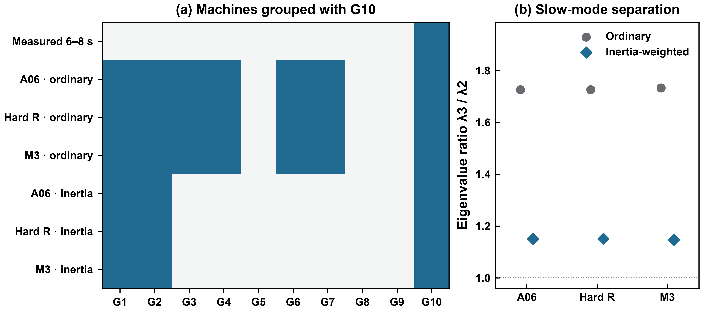
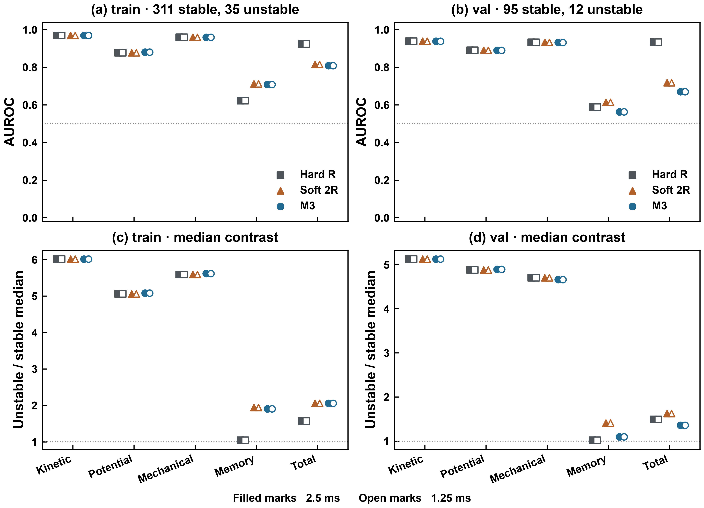

# M4 v2 起报储能分布图附记

[返回主题页](../README.md)

## 运行结果与归档

- [分析运行结果（归档）](../../../../results/backup/10_postfault_structure/08_m4_v2_energy.DESCRIPTION.md#run-2)
- [首次失败运行结果（归档）](../../../../results/backup/10_postfault_structure/08_m4_v2_energy.DESCRIPTION.md#run-1)

登记文件与配置

[方案](../../../../configs/experiments/postfault_m4_v2.toml)

## 执行协议

### M4 v2 惯量加权同调与起报能量

在同一十机骨架和相同归档事件上核对两个物理问题。只读取 A06、V4、M3b 和 M4 v1 封存的参数、预处理与证据。模型参数固定，三组分别为 V4 原硬 R、V4 软 2R 与 M3b G2。分析范围是来源限定的 train 346 例和 val 107 例，使用 2.5 ms 和 1.25 ms 归档记录。真实轨迹缓存与 test 读取为 0，新仿真、自由推演、拟合、梯度和参数更新均为 0。

用已有 45 条基准刚度构造图拉普拉斯。对 A06、V4 原硬 R 和 M3b G2 比较普通谱与惯量广义谱。求解对称矩阵 \(M^{-1/2}LM^{-1/2}\)，还原机器向量 \(u=M^{-1/2}y\)，用第二特征向量的符号二分。分别报告参考分群的配对一致率、调整兰德指数、\(\lambda_3/\lambda_2\)、特征残差与惯量正交误差。参考值为 M4 v1 中 95 例稳定 val 事件起报后 6–8 秒的转速同调分群。分群保留全部十机。

在同一观测起报点分开计算动能 T、移位耦合势能 U、机械暂态能 T+U、记忆储能以及总储能。使用真实冻结标签，失稳为正类，分别给出 AUROC、两组四分位和失稳组与稳定组的中位数比。检验同一参数的 V4 硬、软半径是否逐例保持相同 T+U，并量化两者记忆分量与总储能排序的变化。能量比较用于固定名单区分度。

一次执行，核对已有工件的 SHA256 与精确来源名单。逻辑归档读取上限为十三项，含三组、两名单各自的预测清单及诊断数据共十二项，以及一次 M4 v1 同调参照。输出广义谱、能量逐例结果、慢同调图及能量分解图。所有读操作与零模型更新状态进入回执。

## 报告与结果

### M4 v2 起报储能分布图附记

固定 train（稳定 311、失稳 35）和 val（稳定 95、失稳 12）中，V4 硬 R、V4 软 2R 和 M3b G2 的五行分别展示动能、移位势能、机械能、记忆储能和总储能。箱体为第一至第三四分位数，横线为中位数，须端为 1.5 倍四分位距界内的最远观测，空心圆为界外观测。前三行采用双曲反正弦纵轴（尺度参数 2），保留负势能，后两行采用线性纵轴。同一行的 train 和 val 共用数值范围，刻度均标原储能值。

同组 2.5 ms 实线与 1.25 ms 点线在同一位置绘制。60 组箱体的四分位数及中位数在两档间最大绝对差为 2.97×10⁻⁵，须端的最大绝对差为 4.17×10⁻⁶。界外样本名单逐组相同，图中空心圆取 2.5 ms 观测值。V4 软 2R 与硬 R 的机械能分布逐例相同，软 2R 的记忆分布更宽。以 val 稳定组为例，记忆储能的四分位区间从 [15.80, 18.79] 增至 [17.84, 60.21]。

| SHA-256 核验对象 | 摘要 |
|---|---|
| M4 v2 运行的 `energy_decomposition.json` | `e9c731005b526337b346016c68f4ba6d109613dffc36a2ae13cff016f33ff8ed` |
| `energy_decomposition_distribution.png`（600 DPI） | `5d512383c20f1864f4adc96ef0bec518f2864547f7239a4ff4ae0aa7829862b8` |
| `energy_decomposition_distribution.svg`（矢量图形及可编辑文字） | `c7de7c5b2739e8588e239608e79563dfff3a7ad72b5a6f7300ef7f7be5bcb64e` |

### M4 v2　惯量加权的机组分群与起报储能

在 95 个稳定 val 样本起报后 6–8 秒的转速中，G10 单独成组。引入机组惯量后，三种有效刚度图都把 G10 所在组从七台缩小到 G1、G2、G10 三台，与转速分群一致的机组对由 21/45 增至 29/45。起报机械能在三个冻结模型上的 val AUROC 均约为 0.93。相同 V4 方程改用软 2R 初态后，机械能逐例相同，而总储能的 val AUROC 由 0.9333 降至 0.7175。

#### 惯量对机组分群的影响

45 条有效边的基准刚度构成矩阵 $L=B\,\mathrm{diag}(k)B^\top$。普通谱按 $L$ 的第二特征向量分群；广义谱求解 $Lu=\lambda Mu$，其中 $M$ 是十台机组的惯量对角阵。两种方法都按第二特征向量的正负分成两组。参考分群取 M4 v1 保存的稳定 val 尾段转速，每个样本等权。45 对机组是同一张十机图的无序配对，每对各比较一次两台机器是否同组。[分析协议](#doc-d8e35716192b) · [参考分群及方法](../m4_m3b/README.md#doc-82d48d3bb40e)

| 有效刚度图 | 普通谱 λ₃/λ₂ | 惯量广义谱 λ₃/λ₂ | 与实测分群一致的机组对（普通 → 加权） | 调整兰德指数（普通 → 加权） |
|---|---:|---:|---:|---:|
| A06 | 1.72599 | 1.15006 | 21/45 → 29/45 | −0.1111 → 0.2593 |
| V4 硬 R | 1.72599 | 1.15006 | 21/45 → 29/45 | −0.1111 → 0.2593 |
| M3b G2 | 1.73263 | 1.14679 | 21/45 → 29/45 | −0.1111 → 0.2593 |

按 G1–G10 编号，三张图的普通谱均将 G5、G8、G9 分为一组，其余七台为另一组。惯量加权后，G1、G2、G10 为一组，G3–G9 为另一组。与观察到的 G10 单独成组相比，广义谱仍将 G1、G2 与 G10 分在一起。加权后，第三与第二特征值之比接近 1.15，两个低频方向的分隔较普通谱更小。本比较检验基准刚度和惯量给出的空间分群，完整含阻尼、记忆的局部动力学频率另见 M4 v1。两个谱问题的第二特征值在三种图上均为单根，最大相对特征残差为 $2.86\times10^{-16}$，相应内积下的最大正交误差为 $3.61\times10^{-15}$。

蓝色方格为与 G10 同组的机组。实测一行来自全部 95 个稳定 val 样本。[可编辑分群图](_sealed/figures/slow_coherency_comparison.svg)

#### 起报储能对失稳样本的区分度

起报点是故障清除后 100 ms。动能 $T$ 使用实测质心相对转速和机组惯量，$U$ 是冻结方程的移位耦合势能，机械能为 $T+U$，总储能为机械能加十个隐态的记忆储能。AUROC 以失稳为正类，表示随机取一对失稳和稳定样本时，失稳样本能量排在前面的概率，并列取半权。表中每个样本等权，储能沿用方程的归一化尺度。中位数比为失稳组中位数除以稳定组中位数。

V4 硬 R 与 V4 软 2R 的冻结参数文件哈希相同。两组的机械能在全部 453 个事件上逐例相同，总储能之差与记忆储能之差的最大绝对偏差为 $1.43\times10^{-14}$ 以内。改用软 2R 后，总储能 AUROC 在 train 下降 0.1090，在 val 下降 0.2158。以 val 为例，稳定样本的记忆储能四分位区间由 [15.80, 18.79] 扩展到 [17.84, 60.21]，与失稳样本的 [31.08, 62.17] 有较大重叠。这一配对比较把总储能排序的变化定位到初态求解产生的记忆分量。M3b 同时使用不同的边刚度和基础阻尼，其 val 总储能 AUROC 为 0.6702，机械能为 0.9316。上述 AUROC 描述固定名单上的区分度；事件级临界储能阈值仍待另行验证。

实心和空心标记分别对应 2.5 ms 与 1.25 ms。两档步长下，三模型、两个名单、五项储能的 30 组 AUROC 逐项相同。中位数比的最大绝对差为 $2.02\times10^{-7}$，四分位统计量的最大绝对差为 $2.97\times10^{-5}$。下表列 2.5 ms 结果，方括号内依次为第一四分位数、中位数、第三四分位数。回执另存两档的完整精度。[可编辑能量图](_sealed/figures/energy_decomposition_auroc.svg) · [核验回执](_sealed/postfault_m4_v2_20261121_evidence.json)

##### train 的 311 个稳定样本与 35 个失稳样本

| 模型 | 储能项 | AUROC | 稳定组 [Q1, 中位数, Q3] | 失稳组 [Q1, 中位数, Q3] | 中位数比 |
|---|---|---:|---:|---:|---:|
| V4 硬 R | 动能 | 0.9689 | [0.349, 0.868, 1.620] | [3.971, 5.222, 7.870] | 6.0143 |
| V4 硬 R | 势能 | 0.8771 | [0.343, 1.368, 3.243] | [4.230, 6.925, 8.695] | 5.0601 |
| V4 硬 R | 机械能 | 0.9589 | [0.770, 2.310, 4.936] | [9.415, 12.920, 16.439] | 5.5927 |
| V4 硬 R | 记忆储能 | 0.6220 | [12.833, 17.782, 18.656] | [17.543, 18.554, 18.727] | 1.0434 |
| V4 硬 R | 总储能 | 0.9239 | [15.619, 19.522, 22.108] | [26.958, 30.667, 34.734] | 1.5709 |
| V4 软 2R | 动能 | 0.9689 | [0.349, 0.868, 1.620] | [3.971, 5.222, 7.870] | 6.0143 |
| V4 软 2R | 势能 | 0.8771 | [0.343, 1.368, 3.243] | [4.230, 6.925, 8.695] | 5.0601 |
| V4 软 2R | 机械能 | 0.9589 | [0.770, 2.310, 4.936] | [9.415, 12.920, 16.439] | 5.5927 |
| V4 软 2R | 记忆储能 | 0.7117 | [14.578, 31.639, 50.261] | [35.264, 61.469, 66.259] | 1.9428 |
| V4 软 2R | 总储能 | 0.8150 | [16.814, 35.537, 56.498] | [45.690, 73.053, 78.316] | 2.0557 |
| M3b G2 | 动能 | 0.9689 | [0.349, 0.868, 1.620] | [3.971, 5.222, 7.870] | 6.0143 |
| M3b G2 | 势能 | 0.8804 | [0.365, 1.466, 3.474] | [4.602, 7.451, 9.312] | 5.0811 |
| M3b G2 | 机械能 | 0.9588 | [0.798, 2.393, 5.165] | [9.865, 13.445, 17.124] | 5.6184 |
| M3b G2 | 记忆储能 | 0.7084 | [15.644, 32.180, 40.827] | [28.122, 61.379, 66.559] | 1.9074 |
| M3b G2 | 总储能 | 0.8089 | [18.583, 35.636, 46.970] | [40.181, 73.314, 79.422] | 2.0573 |

##### val 的 95 个稳定样本与 12 个失稳样本

| 模型 | 储能项 | AUROC | 稳定组 [Q1, 中位数, Q3] | 失稳组 [Q1, 中位数, Q3] | 中位数比 |
|---|---|---:|---:|---:|---:|
| V4 硬 R | 动能 | 0.9386 | [0.492, 0.980, 1.835] | [3.478, 5.025, 6.919] | 5.1262 |
| V4 硬 R | 势能 | 0.8895 | [0.371, 1.353, 3.470] | [5.008, 6.605, 7.903] | 4.8814 |
| V4 硬 R | 机械能 | 0.9325 | [0.850, 2.506, 5.229] | [9.174, 11.786, 13.582] | 4.7033 |
| V4 硬 R | 记忆储能 | 0.5877 | [15.802, 18.390, 18.786] | [17.876, 18.731, 18.826] | 1.0185 |
| V4 硬 R | 总储能 | 0.9333 | [18.343, 20.092, 22.803] | [26.993, 29.920, 32.228] | 1.4892 |
| V4 软 2R | 动能 | 0.9386 | [0.492, 0.980, 1.835] | [3.478, 5.025, 6.919] | 5.1262 |
| V4 软 2R | 势能 | 0.8895 | [0.371, 1.353, 3.470] | [5.008, 6.605, 7.903] | 4.8814 |
| V4 软 2R | 机械能 | 0.9325 | [0.850, 2.506, 5.229] | [9.174, 11.786, 13.582] | 4.7033 |
| V4 软 2R | 记忆储能 | 0.6140 | [17.840, 37.709, 60.206] | [31.077, 53.186, 62.169] | 1.4105 |
| V4 软 2R | 总储能 | 0.7175 | [21.236, 39.848, 64.378] | [43.653, 64.678, 71.003] | 1.6231 |
| M3b G2 | 动能 | 0.9386 | [0.492, 0.980, 1.835] | [3.478, 5.025, 6.919] | 5.1262 |
| M3b G2 | 势能 | 0.8895 | [0.397, 1.448, 3.705] | [5.415, 7.082, 8.508] | 4.8925 |
| M3b G2 | 机械能 | 0.9316 | [0.865, 2.628, 5.486] | [9.647, 12.253, 14.186] | 4.6621 |
| M3b G2 | 记忆储能 | 0.5623 | [20.282, 35.098, 53.186] | [22.161, 38.396, 55.739] | 1.0939 |
| M3b G2 | 总储能 | 0.6702 | [23.368, 36.529, 58.649] | [37.908, 49.627, 66.357] | 1.3585 |

#### 证据范围

本次使用冻结的 train 346 例和 val 107 例，登记访问 13 项既有归档证据。数值核验逐项复算了两档步长的 AUROC、分位数、中位数比、普通谱与广义谱。新仿真、自由推演、拟合、梯度、优化更新、原始数据缓存读取和 test 轨迹读取均为 0。首次执行在读取能量数据的层级上报错，修正读取方式后按独立登记完成本次执行。[首次执行回执](_sealed/postfault_m4_v2_failed_20261121_evidence.json) · [本次执行回执](_sealed/postfault_m4_v2_20261121_evidence.json)

## 回执与附件

- [energy_decomposition_auroc.png](_sealed/figures/energy_decomposition_auroc.png)
- [energy_decomposition_auroc.svg](_sealed/figures/energy_decomposition_auroc.svg)
- [energy_decomposition_distribution.png](_sealed/figures/energy_decomposition_distribution.png)
- [energy_decomposition_distribution.svg](_sealed/figures/energy_decomposition_distribution.svg)
- [slow_coherency_comparison.png](_sealed/figures/slow_coherency_comparison.png)
- [slow_coherency_comparison.svg](_sealed/figures/slow_coherency_comparison.svg)
- [postfault_m4_v2_20261121_evidence.json](_sealed/postfault_m4_v2_20261121_evidence.json)
- [postfault_m4_v2_failed_20261121_evidence.json](_sealed/postfault_m4_v2_failed_20261121_evidence.json)

原件与版本

- [docs/protocols/postfault_m4_v2_zh.md](_sealed/postfault_m4_v2_zh.md)
- [docs/reports/10_postfault_structure/_sealed/postfault_m4_v2_20261121_zh.md](_sealed/original/postfault_m4_v2_20261121_zh.md)
- [docs/reports/10_postfault_structure/figures/postfault_m4_v2/energy_decomposition_distribution_zh.md](_sealed/figures/energy_decomposition_distribution_zh.md)
- [docs/reports/10_postfault_structure/postfault_m4_v2_20261121_zh.md](_sealed/postfault_m4_v2_20261121_zh.md)

